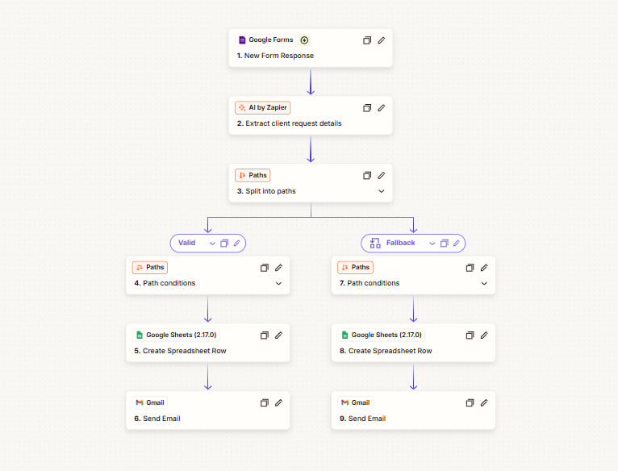
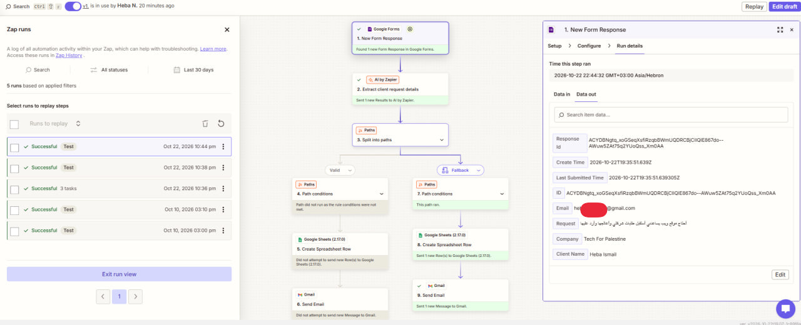
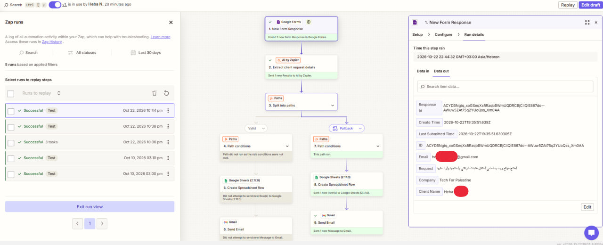
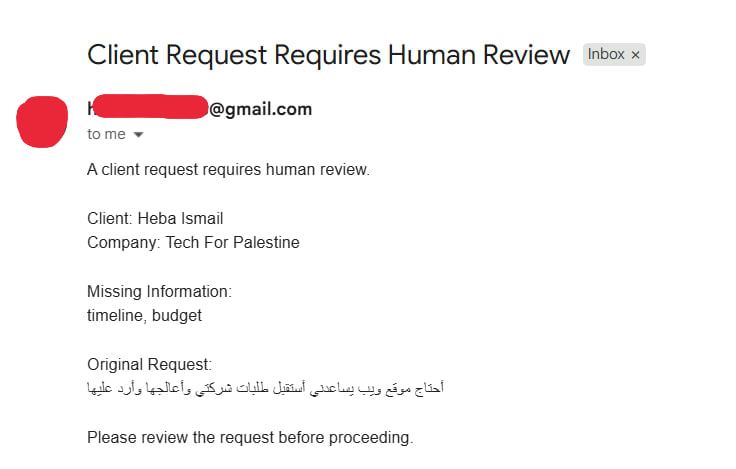
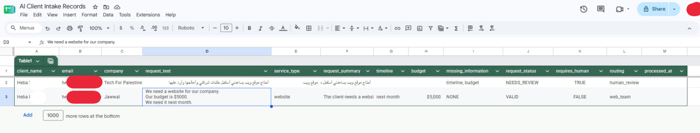

# AI Client Intake & Request Routing

> An AI-assisted client intake workflow that extracts structured information from service requests and routes complete requests to the appropriate team while flagging incomplete requests for human review.

---

## 🎯 Problem

### The Context

Businesses receive client requests containing different service needs, budgets, timelines, and descriptions. These requests may arrive as free text, making it difficult to consistently identify the information needed for an initial assessment.

### The Problem

A request may describe the service but omit essential details such as the budget or expected timeline. If these requests are handled as if all information were available, teams may need additional follow-up before they can assess the request.

Manually reviewing and organizing each submission also creates repetitive administrative work.

### Why It Matters

A structured intake process helps teams identify missing information, organize requests consistently, and direct incomplete submissions to human review rather than treating them as ready for normal processing.

---

## 💡 Solution

This project uses Google Forms, AI by Zapier, Paths by Zapier, Google Sheets, and Gmail to automate the initial handling of client requests.

What does the system do?

1. Receives a client request through Google Forms.
2. Uses AI by Zapier to extract structured information from the request according to explicit instructions.
3. Routes the request through either the `Valid` or `Fallback` path based on the configured path conditions.
4. Creates a Google Sheets record and sends the corresponding email from the selected path.

The workflow is designed to route requests with all required information to the appropriate team and send requests with missing or ambiguous required information for human review.

---

## 👤 Users

**Primary Users:**

- Teams receiving and assessing new client requests.
- Staff responsible for reviewing requests that need clarification.

**User Need:**

Teams need a consistent way to identify the requested service, timeline, and budget, while ensuring requests with missing or ambiguous information receive human attention.

---

## 🧠 How I Designed the Solution

I designed the workflow around structured extraction, explicit decision rules, and separate routing paths.

- **Structured extraction:** AI returns defined fields rather than an unstructured interpretation of the request.
- **No unsupported assumptions:** The AI instructions require using only information explicitly provided by the client.
- **Explicit completeness rules:** A request is considered `VALID` only when `service_type`, `timeline`, and `budget` are all explicitly provided and valid.
- **Separate routing paths:** Requests are directed to the `Valid` or `Fallback` path according to the configured Zapier conditions.
- **Traceable records:** Each executed path creates a record in Google Sheets and sends an email.

The workflow does not use a JavaScript or Code by Zapier step. AI by Zapier extracts the fields and returns the proposed status and routing value; Paths by Zapier applies the configured conditions to select the workflow branch.

---

## ⚙️ How It Works

```text
Google Forms: New Form Response
              ↓
AI by Zapier: Extract Client Request Details
              ↓
Paths by Zapier
       ↙                 ↘
     Valid             Fallback
       ↓                  ↓
Google Sheets:       Google Sheets:
Create Spreadsheet   Create Spreadsheet
Row                   Row
       ↓                  ↓
Gmail: Send Email     Gmail: Send Email
```

### Workflow Steps

| Step | Tool | Responsibility |
|---|---|---|
| 1 | Google Forms | Receives the client's request. |
| 2 | AI by Zapier | Extracts the requested service, timeline, budget, request summary, missing information, request status, and routing value. |
| 3 | Paths by Zapier | Applies the configured conditions and selects the appropriate branch. |
| 4 | Google Sheets | Creates a request record in the branch that runs. |
| 5 | Gmail | Sends the email configured for that branch. |

Both branches use **Create Spreadsheet Row**. The workflow shown does not first create a row and then update that same row.

---

## 🤖 Role of AI

AI by Zapier analyzes the client's request and extracts structured information using explicit instructions.

- **`service_type`:** Extracts the service explicitly requested. If it is not explicitly provided, returns `null`.
- **`timeline`:** Extracts the stated timeframe exactly as written. Vague expressions such as “soon” or “as soon as possible” are treated as missing.
- **`budget`:** Extracts the budget only when the client explicitly provides it; otherwise, returns `null`.
- **`request_summary`:** Summarizes only what the client explicitly requested, without adding assumptions.
- **`missing_information`:** Lists required fields that are missing or ambiguous: `service_type`, `timeline`, and `budget`. Returns `NONE` when nothing is missing.
- **`request_status`:** Returns `VALID` only when all three required fields are explicitly provided and valid; otherwise, returns `NEEDS_REVIEW`.
- **`routing`:** Returns `web_team` for `VALID` requests and `human_review` for `NEEDS_REVIEW` requests.

### What AI Should NOT Do

- Invent, infer, estimate, or guess details that the client did not explicitly provide.
- Convert a vague timeframe into a specific date or timeframe.
- Treat a request as `VALID` when a required field is missing or ambiguous.
- Return routing values outside the defined rules.

The AI instructions define the expected extraction and decision values. Zapier Paths then evaluates its configured conditions to choose which branch runs.

---

## 🔄 Automation

The workflow automates the following tasks:

- Triggering the process when a new Google Forms response arrives.
- Extracting structured request information with AI by Zapier.
- Identifying missing or ambiguous required information according to the AI instructions.
- Routing requests through the configured `Valid` or `Fallback` path.
- Creating a Google Sheets record in the executed path.
- Sending the corresponding email through Gmail.

---

## 🗂️ Data

### Input

The workflow receives a client request through Google Forms. The information shown in the project includes:

- Client name.
- Email address.
- Company.
- Original request text.

The AI extraction rules focus on these required fields:

- `service_type`
- `timeline`
- `budget`

### Output

The extracted and processed request information includes:

- `service_type`
- `timeline`
- `budget`
- `request_summary`
- `missing_information`
- `request_status`
- `routing`

The Google Sheets records shown in the screenshots also include fields such as `client_name`, `email`, `company`, `requestText`, `service_type`, `request_summary`, `timeline`, `budget`, `missing_information`, `request_status`, `requires_human`, `routing`, and `processed_at`.

### Example Outcomes

| Field | Valid Request | Request Requiring Review |
|---|---|---|
| `service_type` | `website` | Extracted if explicitly provided |
| `timeline` | `next month` | Missing |
| `budget` | `$5000` | Missing |
| `missing_information` | `NONE` | `timeline, budget` |
| `request_status` | `VALID` | `NEEDS_REVIEW` |
| `routing` | `web_team` | `human_review` |

The second example reflects the observed test in which the timeline and budget were missing. The service value should be documented according to the actual AI output in the spreadsheet.

---

## 🛠️ Tools & Technologies

| Tool | Purpose |
|---|---|
| Google Forms | Collect client request submissions. |
| AI by Zapier | Extract structured information and return status and routing values according to defined rules. |
| Paths by Zapier | Evaluate path conditions and route the workflow. |
| Google Sheets | Store request records. |
| Gmail | Send the corresponding client-request or human-review email. |

---

## 🔑 Key Design Decisions

### Decision 1: Use Explicit Extraction Rules

**Decision:**

Require AI to use only information explicitly provided by the client and to return `null` when a required detail is not stated.

**Why:**

This reduces unsupported assumptions and makes missing information visible instead of silently filling gaps.

### Decision 2: Define Required Fields

**Decision:**

Require `service_type`, `timeline`, and `budget` to be explicitly provided and valid before a request can receive `VALID` status.

**Why:**

These fields are necessary for the initial request assessment. Missing or ambiguous information should be surfaced for human review.

### Decision 3: Separate the Routing Paths

**Decision:**

Use separate `Valid` and `Fallback` paths in Zapier.

**Why:**

The two paths support different outcomes: normal handling for complete requests and human review when required information is missing or ambiguous.

### Decision 4: Create Records Within Each Path

**Decision:**

Use a Google Sheets `Create Spreadsheet Row` action in each branch.

**Why:**

Each request is recorded through the branch that runs. This matches the configured workflow shown in the evidence.

---

## 🧪 Testing

The following scenarios were executed in the configured Zapier workflow. Results below are based on the supplied screenshots of the workflow runs, spreadsheet records, and emails.

### Test 1: Valid Client Request

**Input:**

A client requests a website for their company, states a budget of `$5000`, and specifies `next month` as the timeframe.

**Expected Result:**

- AI extracts `website`, `$5000`, and `next month`.
- `missing_information` is `NONE`.
- `request_status` is `VALID`.
- `routing` is `web_team`.
- The `Valid` path creates a Google Sheets row and sends the valid-request email.

**Actual Result:**

The spreadsheet shows the request with `service_type = website`, `timeline = next month`, `budget = $5000`, `missing_information = NONE`, `request_status = VALID`, and `routing = web_team`. The valid-request email was received.

**Status:** ✅ Passed

---

### Test 2: Missing Timeline and Budget

**Input:**

A client submits a request in Arabic. The request does not explicitly provide a timeline or budget.

**Expected Result:**

- AI identifies the missing required information.
- `missing_information` includes `timeline, budget`.
- `request_status` is `NEEDS_REVIEW`.
- `routing` is `human_review`.
- The `Fallback` path creates a Google Sheets row and sends a human-review notification.

**Actual Result:**

The spreadsheet shows `timeline` and `budget` as missing, `request_status = NEEDS_REVIEW`, and `routing = human_review`. The human-review email was received.

**Status:** ✅ Passed

---

## 📸 Evidence

The screenshots below document the workflow and the two tested scenarios. Use redacted copies of the screenshots before publishing them in a public repository.

### Workflow Overview



The workflow connects Google Forms, AI by Zapier, Paths, Google Sheets, and Gmail. The two branches each create a spreadsheet row and send an email.

### Test 1: Valid Client Request

#### 1. Zapier Workflow Execution



The run shows the request being processed and the `Valid` branch executing.

#### 2. Valid Request Email


The email confirms that a valid client request was received and displays the extracted request details.

### Test 2: Human Review Required

#### 1. Zapier Workflow Execution



The run shows the `Fallback` branch executing for a request with missing required information.

#### 2. Human Review Email



The notification identifies the request that requires review and lists the missing information.

### Spreadsheet Records



The spreadsheet shows the stored request records and their extracted fields, including the different status and routing outcomes.

---

## ⚠️ Challenges & Failures

### What Needed Careful Handling?

- Client requests can omit required information or use vague wording.
- AI extraction must not fill in missing details through assumptions or guesses.
- The workflow needs to distinguish complete requests from those that require human review.

### How Did I Address These Challenges?

- Defined explicit extraction rules for service type, timeline, and budget.
- Specified how vague timeframes and missing values should be handled.
- Defined allowed values for `request_status` and `routing`.
- Used separate Zapier paths to handle valid requests and requests requiring review.

---

## 📚 What I Learned

### Technical Lesson

AI extraction can produce structured fields that are easier to store and route than free-text requests. Clear field definitions and output rules are important for making the results usable in an automation workflow.

### Problem-Solving Lesson

A missing detail should be represented explicitly rather than guessed. Defining required fields and routing conditions makes the process easier to reason about and test.

### AI Lesson

AI can interpret free-text requests and organize explicitly provided information, but its instructions should clearly prohibit invented details and define how uncertainty is handled.

---

## 🔮 Future Improvements

If I continued developing this project, I would:

- Add explicit error handling and notifications for failed workflow steps.
- Expand the test set to cover vague timelines, missing service types, ambiguous budgets, and unusual request formats.
- Add duplicate-submission handling and a clearer audit trail.
- Review the AI output against the extraction rules using additional test cases.

---

## 🔗 Project Links

**Client Intake Form:** [Open the Client Intake Form](https://docs.google.com/forms/d/e/1FAIpQLSe20O1dJJgpxQJP3oekx_zs_hb5qGz9xYhNC14c5AhvsFY_9g/viewform)

**Workflow:** [Open the Zapier Workflow](https://zapier.com/editor/383094866/published)

---

## 👩‍💻 Author

**Heba Nedal**

[LinkedIn](https://www.linkedin.com/in/heba-n-ismail-b836b2377/) · [GitHub](https://github.com/heba-nedal)
