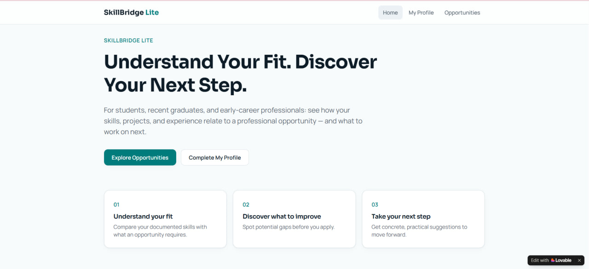
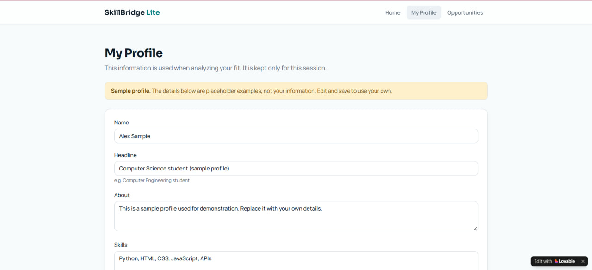
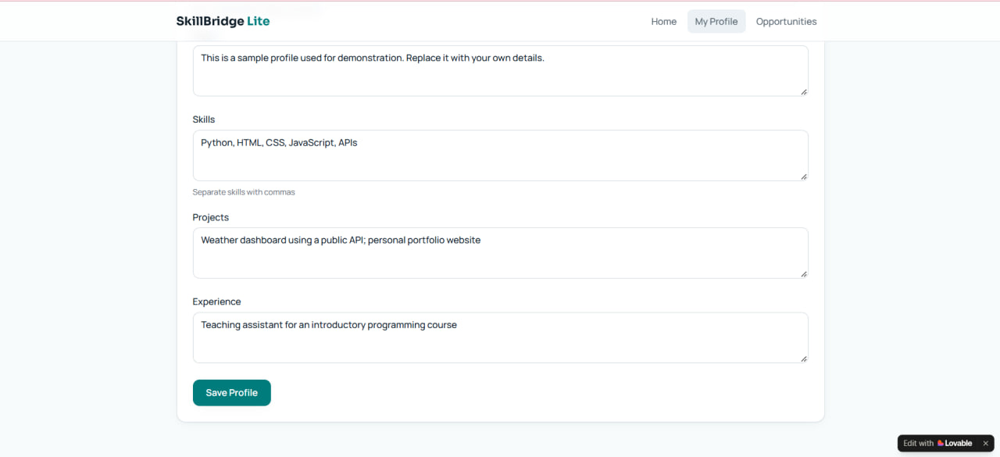
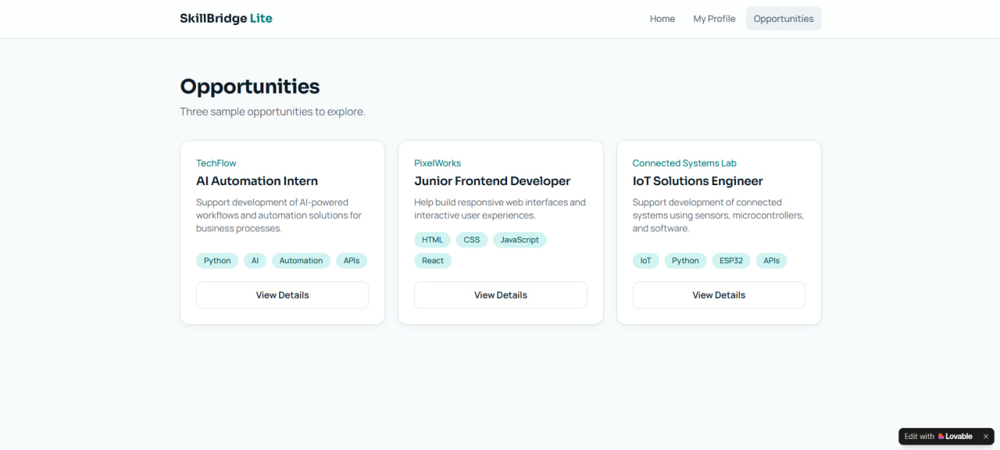
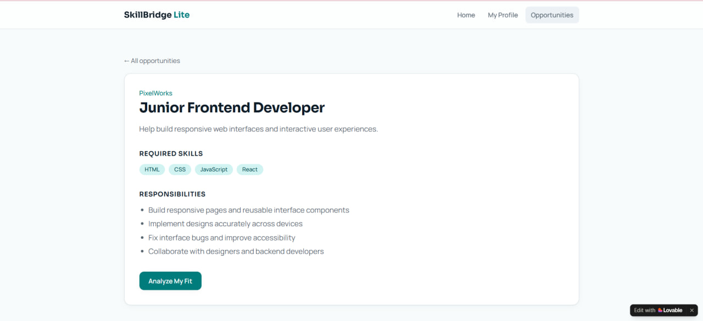
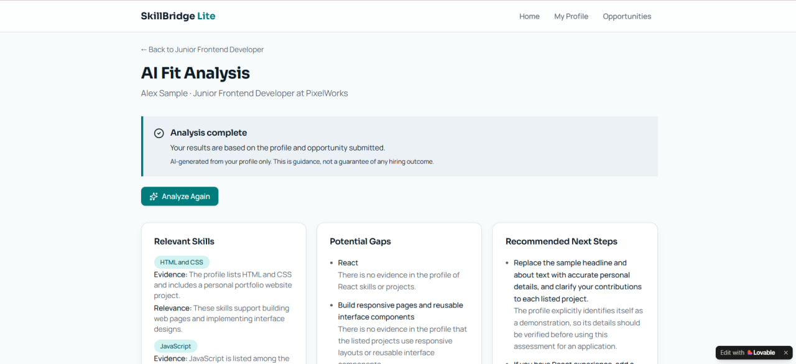
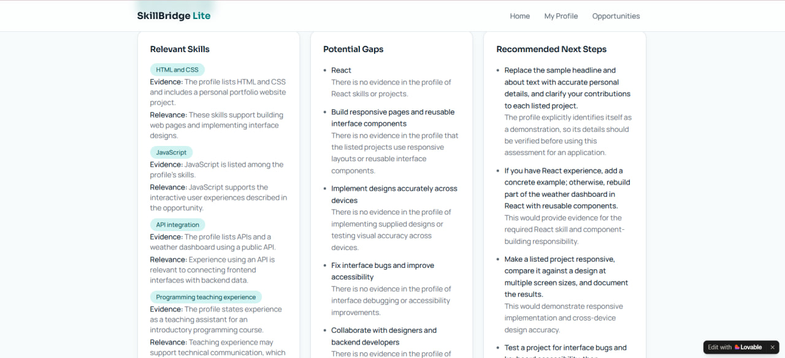

# SkillBridge Lite — AI-Powered Career Fit Assistant

> A web application that helps early-career professionals understand how their skills and experience relate to a selected career opportunity through AI-powered feedback.

---

## 🎯 Problem

### The Context

Students, recent graduates, and early-career professionals may have different skills, projects, and experiences but lack a clear way to connect them to the requirements of a specific career opportunity.

### The Problem

It can be difficult to identify which documented skills are relevant to an opportunity, which requirements lack supporting evidence, and what steps could improve a professional profile.

### Why It Matters

A clearer understanding of the relationship between a professional profile and an opportunity helps users identify strengths, recognize areas for improvement, and make more informed decisions about their career development.

---

## 💡 Solution

SkillBridge Lite provides a simple web application where users can review and edit their professional profile, explore predefined opportunities, and request feedback about their fit for a selected opportunity.

What does the system do?

1. Allows users to review and edit their professional profile.
2. Displays three predefined career opportunities.
3. Shows the details, required skills, and responsibilities of a selected opportunity.
4. Presents fit-analysis feedback in three sections: relevant skills, potential gaps, and recommended next steps.

---

## 👤 Users

**Primary Users:**  
Students, recent graduates, and early-career professionals.

**User Need:**  
Understand how their documented skills, projects, and experience relate to a specific professional opportunity and identify practical next steps for improvement.

---

## 🧠 How I Designed the Solution

I designed the application around one primary user and a focused minimum viable product (MVP). Instead of building a complete recruitment platform, I limited the scope to professional profile editing, opportunity exploration, opportunity details, and AI fit analysis.

The application uses three predefined opportunities and does not require authentication or a database. This keeps the prototype focused on its main purpose while avoiding unnecessary complexity during implementation.

The analysis interface separates relevant skills, potential gaps, and recommended next steps to make the feedback easier to understand and act upon.

---

## ⚙️ How It Works

```text
Professional Profile
        ↓
Select an Opportunity
        ↓
AI Fit Analysis
        ↓
Relevant Skills + Potential Gaps
        ↓
Recommended Next Steps
```

---

## 🤖 Role of AI

What does AI do in this solution?

- Identifies documented skills and experience relevant to the selected opportunity.
- Highlights requirements for which the profile provides insufficient supporting evidence.
- Suggests practical next steps to help users improve their professional profile or prepare for the opportunity.

### What AI Should NOT Do

- Invent skills, qualifications, projects, or experience that the user has not provided.
- Treat missing information as definitive proof that the user lacks a skill.
- Guarantee hiring outcomes or present its assessment as a final judgment of the user's abilities.

---

## 🔄 Automation

What parts of the process are automated?

- The application organizes the professional profile and selected opportunity as inputs for the analysis.
- The fit-analysis workflow is designed to generate feedback through AI.
- The resulting feedback is presented in three sections: relevant skills, potential gaps, and recommended next steps.

The application does not automate job applications, recruitment decisions, or external job searches.

---

## 🗂️ Data

### Input

**Professional Profile**
- Name
- Professional headline
- About
- Skills
- Projects
- Experience

**Selected Opportunity**
- Title
- Company
- Description
- Required skills
- Responsibilities

The professional profile is managed in application state, and the three opportunities are predefined in the application.

### Output

The analysis interface presents three categories of feedback:

- **Relevant Skills:** Skills and experience related to the selected opportunity, with supporting evidence and relevance explanations.
- **Potential Gaps:** Requirements for which sufficient supporting evidence is not present in the profile.
- **Recommended Next Steps:** Practical actions intended to improve the user's preparation or professional profile.

Profile changes are not persisted across page reloads in the current implementation.

---

## 🛠️ Tools & Technologies

| Tool | Purpose |
|---|---|
| Lovable | AI-assisted application building and publishing |
| Frontend web application | User interface, navigation, profile editing, and opportunity views |
| AI-powered analysis | Career-fit feedback presented through the analysis interface |

---

## 🔑 Key Design Decisions

### Decision 1

**Decision:**  
Limit the application to one primary user and five core views: Home, My Profile, Opportunities, Opportunity Details, and AI Fit Analysis.

**Why:**  
This keeps the user journey focused and makes the MVP manageable within the training scope.

### Decision 2

**Decision:**  
Use three predefined opportunities instead of building a dynamic opportunity management system.

**Why:**  
The project demonstrates the core career-fit workflow without requiring a complete job marketplace or opportunity management backend.

### Decision 3

**Decision:**  
Keep authentication and database integration outside the current MVP.

**Why:**  
The primary goal is to demonstrate the application flow without adding account management or backend infrastructure.

### Decision 4

**Decision:**  
Separate analysis results into relevant skills, potential gaps, and recommended next steps.

**Why:**  
This structure helps users distinguish existing evidence from areas requiring further development and actionable recommendations.

---

## 🧪 Testing

### Test 1 — Navigation and Profile

**Input:**  
Open the published application and navigate to My Profile and Opportunities.

**Expected Result:**  
The main views are accessible, the profile form is displayed, and the three predefined opportunities appear.

**Actual Result:**  
The provided screenshots show the home page, profile form, and all three opportunity cards.

**Status:** ✅

---

### Test 2 — Opportunity Details and Analysis

**Input:**  
Select an opportunity, open its details, and navigate to AI Fit Analysis.

**Expected Result:**  
The selected opportunity's details are displayed, and the analysis interface provides relevant skills, potential gaps, and recommended next steps.

**Actual Result:**  
The provided screenshots show the Junior Frontend Developer details page and an analysis result containing the three required sections.

**Status:** ✅

---

## 📸 Evidence

### Final Result — Home Page



### Professional Profile





### Opportunities



### Opportunity Details



### AI Fit Analysis





---

## ⚠️ Challenges & Failures

### What didn't work as expected?

- Profile edits are not preserved after a page reload.
- The three career opportunities are predefined rather than dynamically managed.

### How did I solve it?

- Kept profile editing within the application's state to avoid introducing a database into the MVP.
- Used predefined opportunities to keep the implementation focused on the core workflow.
- Identified persistent storage, user authentication, and dynamic opportunity management as future improvements.

---

## 📚 What I Learned

### Technical Lesson

A frontend prototype can demonstrate a complete user journey without requiring authentication or a database. However, application state alone does not guarantee that user changes will survive a page reload.

### Problem-Solving Lesson

Defining the MVP before implementation helps prevent unnecessary features from increasing complexity and consuming time and credits.

### AI Lesson

Integrating AI into an application requires more than displaying generated text. The application must provide the model with the correct context, including the user's professional profile and the selected opportunity, to generate relevant and useful feedback.

AI-generated feedback should be evidence-based, actionable, and transparent about its limitations. In SkillBridge Lite, the analysis identifies relevant skills, highlights potential gaps, and recommends next steps without inventing qualifications or guaranteeing hiring outcomes.

---

## 🔮 Future Improvements

If I continued developing this project, I would:

- **Database Integration:** Persist professional profile information beyond the current application session.
- **User Authentication:** Introduce user accounts so each user can securely manage their own profile.
- **Dynamic Opportunity Management:** Store opportunities in a database instead of using three predefined records.
- **Analysis History:** Allow users to revisit previous analyses and track their progress over time.

These improvements are outside the current MVP scope.

---

## 🔗 Project Links

**Live Demo:** [SkillBridge Lite](https://skill-bridge-lite-by-heba.lovable.app)

**Repository:** [Github Repository](https://github.com/heba-nedal/SkillBridge-Lite.git)

---

## 👩‍💻 Author

**Heba Nedal**

[LinkedIn](https://www.linkedin.com/in/heba-n-ismail-b836b2377/) · [GitHub](https://github.com/heba-nedal)
