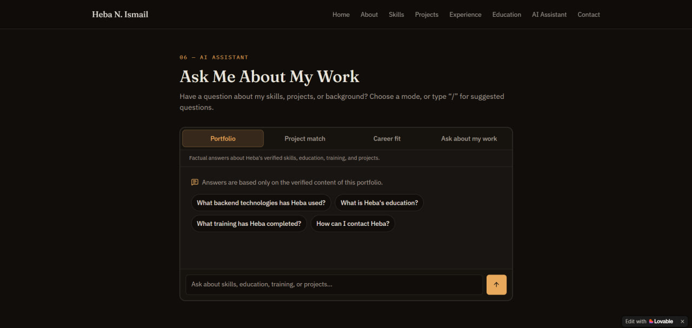
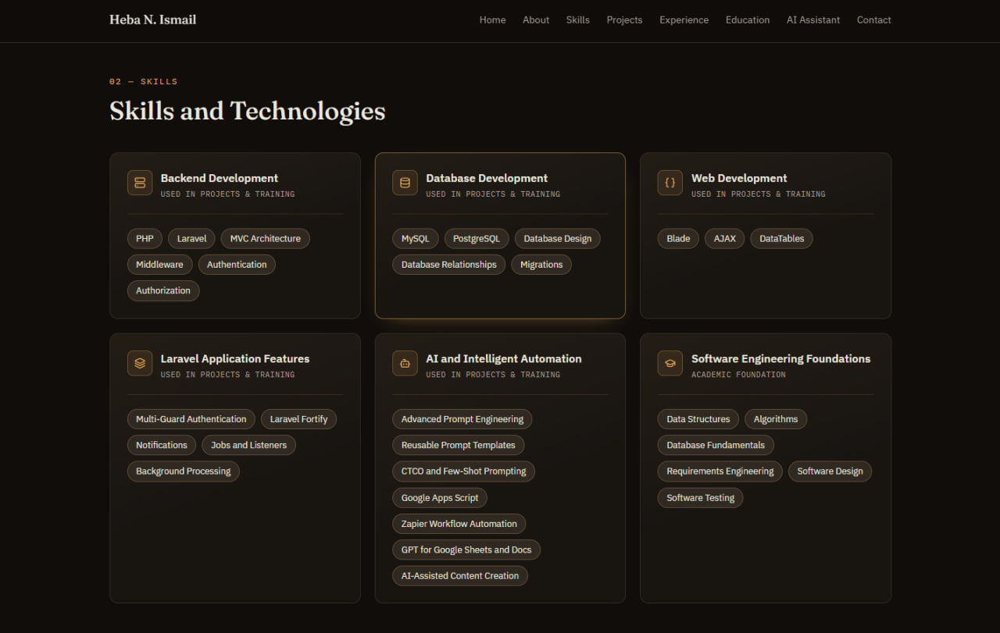
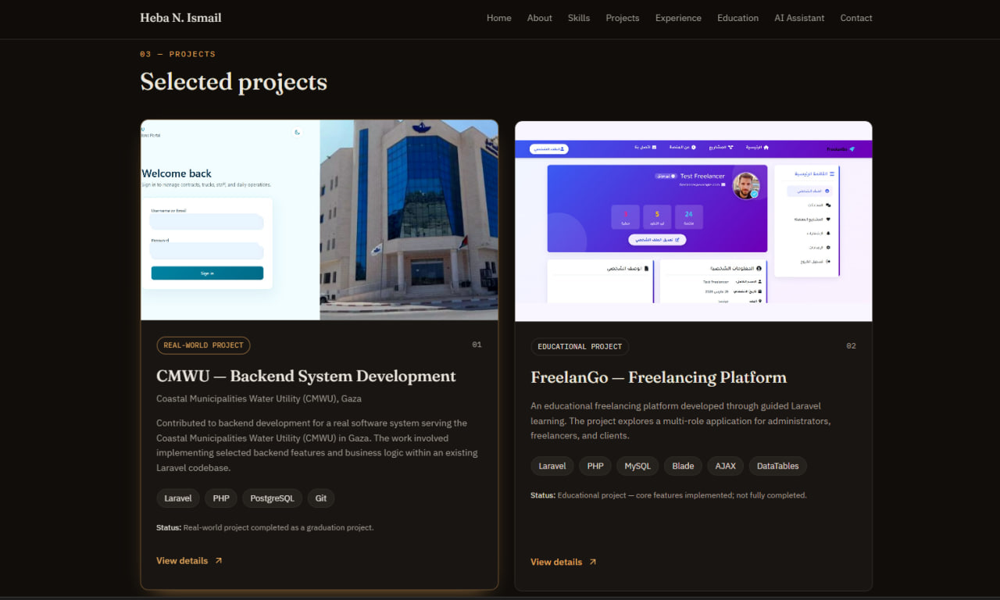
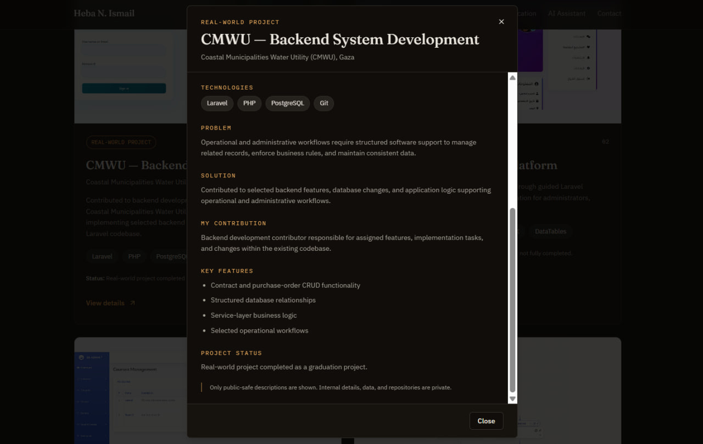
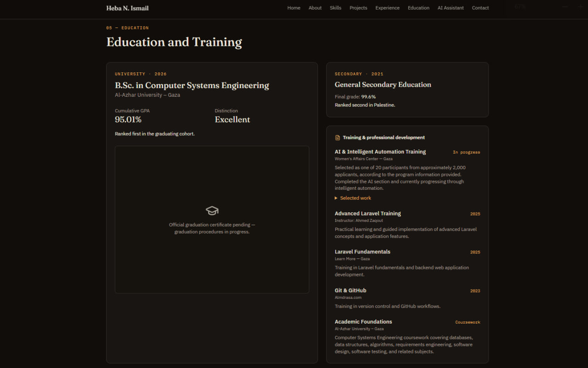

# Professional Portfolio with AI

> An AI-powered professional portfolio that showcases real skills, projects, and education while helping visitors explore professional information through an interactive, evidence-based AI assistant.

---

## 🎯 Problem

### The Context

A professional portfolio helps recruiters, potential clients, and collaborators understand a developer's background, technical skills, and project experience.

### The Problem

Traditional portfolios mainly present static information. Visitors may need to browse several sections to find specific details about a developer's skills, understand their contribution to a project, or identify work relevant to their needs.

### Why It Matters

A portfolio should do more than display a CV. It should make professional information easy to explore, present projects transparently, and help visitors find reliable answers without manually searching through every section.

---

## 💡 Solution

I built a professional portfolio using Lovable and enhanced it with an AI assistant that helps visitors explore my professional background and projects.

The system combines a structured portfolio with AI-powered interactions grounded in documented portfolio information.

What does the system do?

1. Presents my professional identity, biography, skills, projects, practical experience, education, and training.
2. Allows visitors to explore project details, including the problem, solution, my contribution, technologies, and project status.
3. Provides a downloadable CV and clear contact options.
4. Uses an AI assistant to answer questions, recommend relevant projects, compare career requirements with documented evidence, and explain my work.

---

## 👤 Users

**Primary Users:**  
Recruiters, hiring managers, potential freelance clients, technical collaborators, and visitors interested in my professional background.

**User Need:**  
Visitors need to understand my skills and experience, explore relevant projects, and obtain specific information quickly and reliably.

---

## 🧠 How I Designed the Solution

I approached the portfolio as a professional application rather than a static CV.

I identified the main visitor needs and organized the information into dedicated sections. I also designed the AI assistant around four modes: Portfolio, Project Match, Career Fit, and Ask About My Work.

A central portfolio content file provides information to both the website and the AI assistant. This helps maintain consistency and reduces the risk of the assistant generating claims that are not supported by the portfolio.

I also distinguished real-world project work from educational projects and training prototypes so visitors can understand the context and status of each project.

---

## ⚙️ How It Works

```text
Visitor
   ↓
Explore Portfolio or Ask a Question
   ↓
Select an AI Mode (if using the assistant)
   ↓
Portfolio Content / Visitor Question
   ↓
AI Processing with Portfolio Context
   ↓
Answer or Relevant Portfolio Information
   ↓
Explore Projects, Learn More, or Contact Me
```

---

## 🤖 Role of AI

AI helps visitors interact with the portfolio using natural-language questions instead of relying only on manual navigation.

- **Portfolio:** Answers factual questions about documented skills, education, training, and projects.
- **Project Match:** Helps identify projects relevant to a visitor's needs and explains the connection.
- **Career Fit:** Compares job requirements with documented skills and experience, highlighting supporting evidence and potential gaps.
- **Ask About My Work:** Answers deeper questions about project functionality, technologies, and contributions.

The assistant uses portfolio information supplied by the application and mode-specific instructions to generate relevant responses.

### What AI Should NOT Do

- Invent skills, qualifications, achievements, clients, or professional experience.
- Present educational projects or training prototypes as paid professional employment.
- Claim that a technology or feature was used when the portfolio does not document it.
- Guarantee hiring outcomes or make unsupported claims about career suitability.
- Fabricate answers when the required information is unavailable.

When the portfolio does not contain enough information to answer a question, the assistant is instructed to use a fallback response rather than invent details.

---

## 🔄 Automation

The application automates parts of the visitor's information-discovery process.

- Processes visitor questions through a server-side AI endpoint.
- Supplies portfolio context and mode-specific instructions to the AI model.
- Generates and streams responses to the interface.
- Organizes AI interactions into predefined modes with relevant suggested questions.
- Handles request failures and provides retry functionality.

The system automates question answering and information discovery; it does not use a scheduled or background automation workflow.

---

## 🗂️ Data

### Input

The application uses structured portfolio content, including:

- **Profile:** Name, professional title, location, and biography.
- **Skills:** Technical skills grouped into categories.
- **Projects:** Descriptions, technologies, contributions, key features, and status.
- **Experience:** Practical project work and current training.
- **Education:** University education and secondary education.
- **Training:** Professional development programs and learning activities.
- **Contact:** Email, GitHub, LinkedIn, and CV information.
- **AI Input:** Visitor questions, conversation history, and the selected assistant mode.

The central portfolio content is maintained in `src/content/portfolioContent.ts`.

### Output

- Rendered portfolio sections and project details.
- A downloadable CV.
- AI-generated answers based on the portfolio context.
- Project recommendations and explanations.
- Career-fit feedback identifying documented evidence and potential gaps.
- Technical explanations about projects and skills.
- Error or fallback messages when a request fails or information is unavailable.

---

## 🛠️ Tools & Technologies

| Tool | Purpose |
|---|---|
| Lovable | AI-assisted application development |
| React 19 | Building the user interface |
| TypeScript | Type-safe application development |
| TanStack Start | Application framework and server-side request handling |
| TanStack Router | Application routing |
| Tailwind CSS | Responsive styling |
| Vite | Development and build tooling |
| Lovable AI Gateway | Accessing the AI model |
| OpenAI GPT-6 Astra | Generating AI assistant responses |
| React Markdown | Rendering formatted AI responses |
| Radix UI | Accessible interface components |
| Vitest | Automated testing |
| React Testing Library | Component interaction testing |
| Git and GitHub | Version control and source-code hosting |

---

## 🔑 Key Design Decisions

### Decision 1

**Decision:**  
Maintain one central source for portfolio information.

**Why:**  
The website and AI assistant need consistent information. Centralizing the content helps reduce duplication and makes it easier to update professional details without maintaining separate versions for the interface and AI context.

### Decision 2

**Decision:**  
Use four specialized AI assistant modes instead of one general-purpose chatbot.

**Why:**  
Visitors have different goals. Separate modes help focus the interaction on factual portfolio questions, project recommendations, career requirements, or technical questions about my work.

---

## 🧪 Testing

### Test 1

**Input:**  
Open the portfolio's root route `/`.

**Expected Result:**  
The application should resolve the root route to the home page.

**Actual Result:**  
An automated routing test is implemented to check that the root route resolves to a page route.

**Status:** ✅ Automated test implemented.

---

### Test 2

**Input:**  
Open a project details dialog, then close it using Escape or the dialog's close control.

**Expected Result:**  
The dialog should display the selected project's details. When it closes, scrolling and keyboard focus should be restored appropriately.

**Actual Result:**  
Automated component tests cover dialog opening, dismissal, scroll locking, and focus restoration.

**Status:** ✅ Automated tests implemented.

---

### Test 3

**Input:**  
Test all four AI assistant modes: Portfolio, Project Match, Career Fit, and Ask About My Work. Switch between modes, ask questions about documented portfolio information, and ask questions that require information not available in the portfolio.

**Expected Result:**  
Each mode should maintain an independent conversation. Conversation history should be saved in the browser's `localStorage` and remain associated with the correct mode. The assistant should generate answers grounded in portfolio content, explain relevant limitations, and acknowledge insufficient information instead of inventing facts.

**Actual Result:**  
All four modes were tested on the published website. Each mode maintained a separate conversation, with conversation history stored in `localStorage`. The assistant answered questions using documented portfolio information, explained relevant limitations, and acknowledged when information was insufficient. No invented information was observed during these tests.

**Status:** ✅ Passed — manually tested on the published website.

---

## 📸 Evidence

### Final Result


### Workflow



### Skills and Technologies



### Projects



### Project Details



### Education and Training



---

## ⚠️ Challenges & Failures

**What didn't work as expected?**

- AI responses can become inaccurate or unsupported when the model lacks sufficient context or clear instructions.
- Different project types can be misunderstood if their status and context are not clearly described.
- Testing the AI assistant requires more than checking whether it generates a response; its answers must also be evaluated for factual consistency and appropriate handling of missing information.

**How did I solve it?**

- Created a centralized portfolio content source and used it to provide context to the AI assistant.
- Added explicit instructions that restrict the assistant to documented information and define how it should handle missing information.
- Classified projects by type and status to distinguish real-world work from educational projects and training prototypes.
- Added loading states, request cancellation, error handling, and retry functionality.
- Tested all four AI assistant modes on the published website and verified that each maintained an independent conversation using `localStorage`, while providing portfolio-grounded answers, explaining limitations, and acknowledging insufficient information rather than inventing facts.


---

## 📚 What I Learned

### Technical Lesson

I learned how to combine a React and TypeScript frontend with server-side request handling and an AI gateway. I also learned the importance of a shared data source when the same information is used by both a website and an AI assistant.

### Problem-Solving Lesson

A useful application begins with understanding the visitor's needs. Organizing information into clear sections, separating AI tasks into specialized modes, and documenting project contributions make the portfolio easier to navigate and understand.

### AI Lesson

AI integration requires more than connecting a model to an application. The model needs relevant context, clear instructions, and rules for handling missing information. A trustworthy AI feature should distinguish documented facts from unsupported assumptions and avoid inventing professional qualifications.

---

## 🔮 Future Improvements

If I continued developing this project, I would:

- Add automated tests for the AI endpoint, response grounding, and fallback behavior.
- Build a repeatable test set covering all four assistant modes and unsupported questions.
- Verify the assistant's behavior on the published website using realistic visitor questions.
- Improve monitoring and visibility into AI request failures.
- Add a content-management workflow if the portfolio needs frequent updates.
- Continue improving accessibility and responsive behavior based on real-device testing.

---

## 🔗 Project Links

**Live Demo:** [Professional Portfolio with AI](https://heba-portfolio.lovable.app)

**Workflow:** Documented in the User Flow and How It Works sections above.

**Repository:** [portfolio-website](https://github.com/heba-nedal/portfolio-website)

---

## 👩‍💻 Author

**Heba N. Ismail**

Backend Software Engineer | Laravel & PHP

[LinkedIn](https://www.linkedin.com/in/heba-n-ismail-b836b2377/) · [GitHub](https://github.com/heba-nedal)
