# TaskBridge

> Turn unclear client requests into clear, actionable plans with prioritized tasks and progress tracking.

---

## 🎯 Problem

### The Context

Freelancers and early-career professionals often handle multiple projects, client requests, deadlines, and deliverables. Without a structured workflow, organizing work and tracking progress can become difficult.

### The Problem

A client request may begin as an unclear description of what needs to be done. Users need to turn that request into a defined goal, organize the work into manageable tasks, and track completion in one place.

### Why It Matters

A clear planning workflow helps users understand what needs to be done, prioritize their work, and monitor progress without losing track of their plans and tasks.

---

## 💡 Solution

TaskBridge is a web application designed to help freelancers and early-career professionals organize plans and manage their associated tasks.

The system allows users to:

1. Create plans with a title, description, goal, and optional deadline.
2. Organize work into tasks with priorities and statuses.
3. Track progress automatically based on completed tasks.
4. Save and retrieve plans and tasks through a persistent database.

---

## 👤 Users

**Primary Users:**

Freelancers and early-career professionals who need a simple way to organize work and manage client requests.

**User Need:**

To turn requests into actionable plans, break work into tasks, prioritize activities, and track progress while keeping their data saved and accessible.

---

## 🧠 How I Designed the Solution

The application is organized around two related entities: **Plans** and **Tasks**.

A plan represents a larger goal or request, while its tasks represent the individual activities required to complete it.

The design follows several principles:

- Keep plans and their tasks logically connected.
- Calculate progress from task completion rather than relying on manual percentage updates.
- Persist changes in a database so they remain available after refreshing the page.
- Associate records with authenticated users.
- Use database-level Row Level Security (RLS) policies to restrict access to user-owned records.

---

## ⚙️ How It Works

```text
User
  ↓
Create a Plan
  ↓
Define Goal and Deadline
  ↓
Add Tasks and Set Priorities
  ↓
Update Task Statuses
  ↓
Supabase Database
  ↓
Calculate and Display Progress
```

---

## 🤖 Role of AI

AI-assisted development was used to help build and refine TaskBridge.

- **Lovable:** Supported application development and UI implementation.
- **AI-assisted problem solving:** Helped investigate implementation questions and potential issues.
- **Recus:** Supported browser-based testing by identifying checks that passed or required further review.

### What AI Should NOT Do

- Replace actual testing or evidence-based verification.
- Be treated as the sole authority on database security.
- Treat every automated test failure as a confirmed application bug without investigating its cause.

*AI is part of the development and testing workflow. This README does not claim that TaskBridge contains a runtime AI feature.*

---

## 🔄 Automation

TaskBridge automates several parts of the planning workflow:

- Saves plan and task changes to the database.
- Calculates progress based on completed tasks.
- Retrieves persisted records when users return to the application.
- Applies database access policies to operations involving user-owned records.

---

## 🗂️ Data

### Input

- Plan title and description.
- Goal and optional deadline.
- Task title and description.
- Task priority and status.
- Authenticated user identity.

### Output

- Saved plans and associated tasks.
- Updated task statuses.
- Completed-task counts and progress percentages.
- User-specific planning information displayed in the application.

---

## 🛠️ Tools & Technologies

| Tool | Purpose |
|---|---|
| Lovable | AI-assisted application development |
| React | User interface |
| TypeScript | Application development and type safety |
| TanStack Router | Client-side routing |
| Supabase | Database and authentication services |
| PostgreSQL | Relational data storage |
| Row Level Security (RLS) | Database-level access control |
| Vitest | Automated testing framework |
| Recus | AI-assisted browser testing |
| PageSpeed Insights | Performance, accessibility, best-practices, and SEO audits |
| GitHub | Source code and project documentation |

---

## 🔑 Key Design Decisions

### Decision 1 — Separate Plans and Tasks

**Decision:**

Store plans and tasks in separate, related database tables.

**Why:**

A single plan can contain multiple tasks. This structure makes it possible to manage individual tasks while keeping them associated with their parent plan.

### Decision 2 — Calculate Progress from Task Status

**Decision:**

Derive progress from the number of completed tasks.

**Why:**

This avoids manually maintaining a progress percentage and allows the displayed progress to update when task statuses change.

### Decision 3 — Enforce User Data Ownership

**Decision:**

Use authenticated user identity and database-level RLS policies.

**Why:**

Access restrictions should be enforced by the database rather than relying only on what the user interface displays.

### Decision 4 — Verify the Application with Evidence

**Decision:**

Combine manual tests, database-policy inspection, browser testing, and performance audits.

**Why:**

A working interface alone does not prove that data persists, user access is restricted correctly, or all interactions behave as expected.

---

## 🧪 Testing

### Test 1 — Data Persistence and Task Updates

**Input:**

Create a plan and task, update the task status, and refresh the page.

**Expected Result:**

The saved records remain available, the updated status persists, and the progress indicator reflects completed tasks.

**Actual Result:**

Manual testing confirmed that plans and tasks remained after refreshing, task updates persisted, and progress updated after changing a task to `Done`.

**Status:** ✅ Pass

---

### Test 2 — Required Field Validation

**Input:**

Submit plan or task forms with empty required fields or whitespace-only titles.

**Expected Result:**

Invalid input is rejected and the user is prompted to provide valid information.

**Actual Result:**

Manual testing confirmed that empty required fields and whitespace-only titles were rejected in the tested scenarios.

**Status:** ✅ Pass

---

### Test 3 — Authentication and User Data Isolation

**Input:**

Access the plans page without signing in and compare the planning data visible under separate user accounts.

**Expected Result:**

Unauthenticated users are redirected to sign in, and users see their own planning data.

**Actual Result:**

The executed manual tests confirmed the login redirect and separate account data in the UI. Supabase Dashboard inspection also confirmed that RLS was enabled on both `plans` and `plan_tasks`, with policies restricting access by authenticated user identity.

**Status:** ✅ Pass for the tested scenarios; this is not a complete security audit.

---

### Test 4 — Deletion and Cancellation

**Input:**

Cancel a plan deletion, then separately delete a test plan and inspect the resulting records.

**Expected Result:**

Canceling leaves the plan unchanged. Confirmed deletion removes the selected plan and its related tasks as expected.

**Actual Result:**

Manual testing confirmed that canceling preserved the plan and that the deleted test plan and related tasks were no longer present in the inspected database.

**Status:** ✅ Pass for the observed behavior.

---

### Test 5 — Automated Browser Testing with Recus

**Input:**

Run automated browser checks against the deployed application.

**Expected Result:**

The tool exercises relevant interactions and reports successful checks, failures, warnings, and supporting evidence.

**Actual Result:**

The shared report summarized 39 passed checks and 6 failed checks. Reported issues included signup rate limiting, possible repeated signup submission, and accessibility checks for which sufficient evidence was not captured.

The failed checks have not all been confirmed as application bugs and require further investigation.

**Status:** ⚠️ Review required

**Report:** [View the Recus test run](https://www.recus.app/shared/runs/bzy9auqydGz7IlQaBDbVAmYV3oWqeK3nN41RkaH-DDI)

---

### Test 6 — Performance and Quality Audit

**Input:**

Run PageSpeed Insights against the deployed application on mobile and desktop.

**Expected Result:**

Evaluate performance, accessibility, best practices, and SEO.

**Actual Result:**

| Metric | Mobile | Desktop |
|---|---:|---:|
| Performance | 86 | 100 |
| Accessibility | 100 | 100 |
| Best Practices | 100 | 100 |
| SEO | 100 | 100 |

The mobile report identified opportunities to reduce render-blocking resources and unused JavaScript. Real-user field data was unavailable in the report.

**Status:** ✅ Audit completed; mobile performance can be improved.

---

## 📸 Evidence

### Final Result — Landing Page

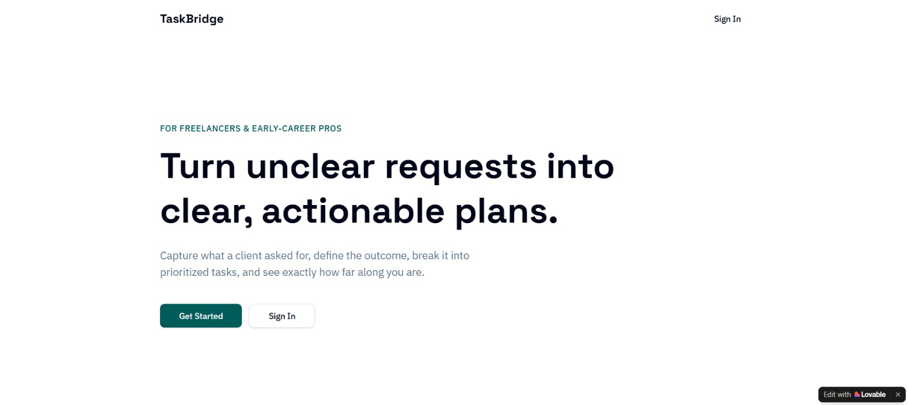

### Plans Dashboard

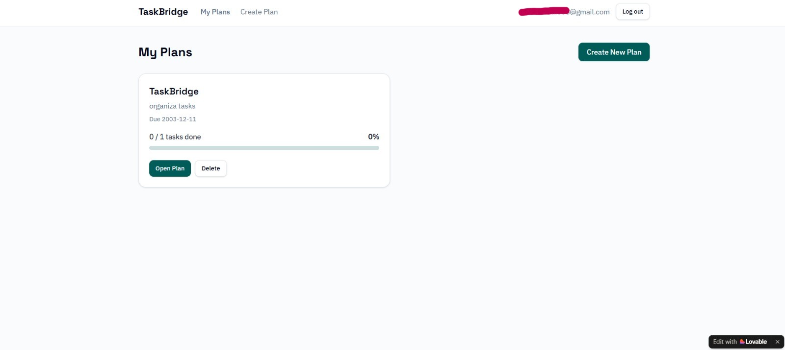

### Create a Plan

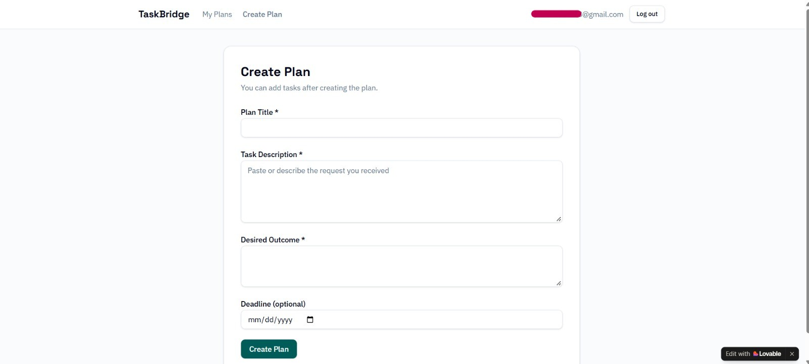

### Plan Details and Task Management

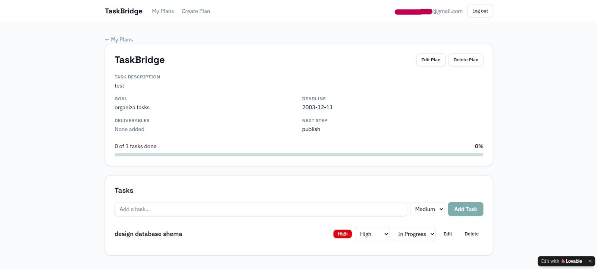

### Database Schema

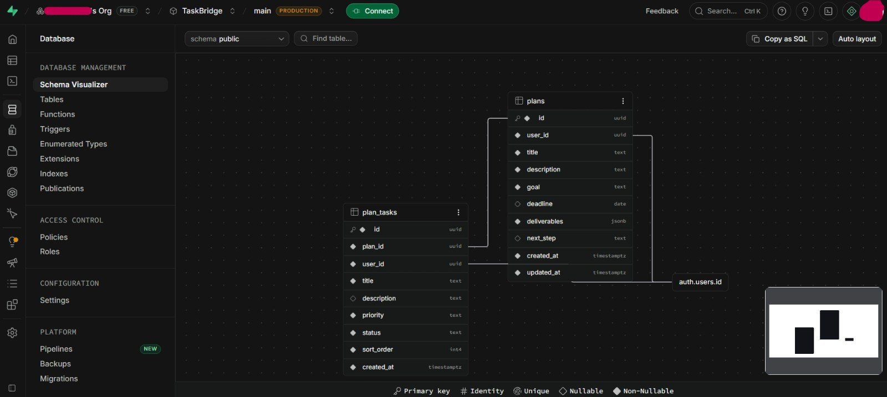

### Supabase Database Tables

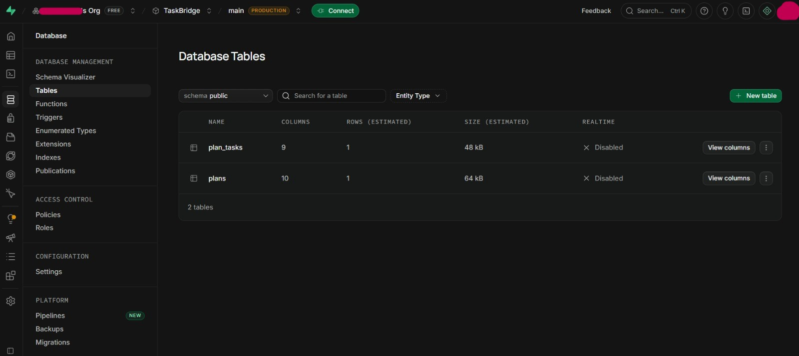

### Authentication

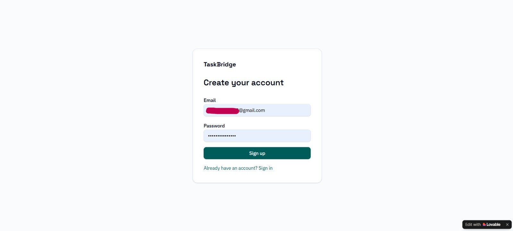

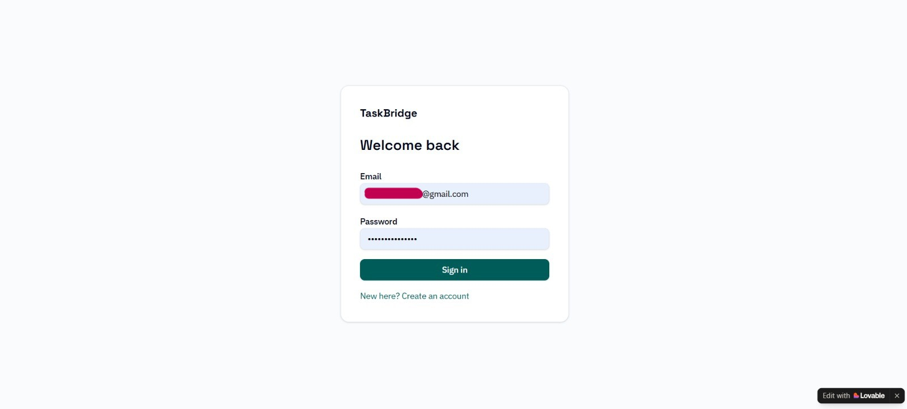

### Database Access Policies

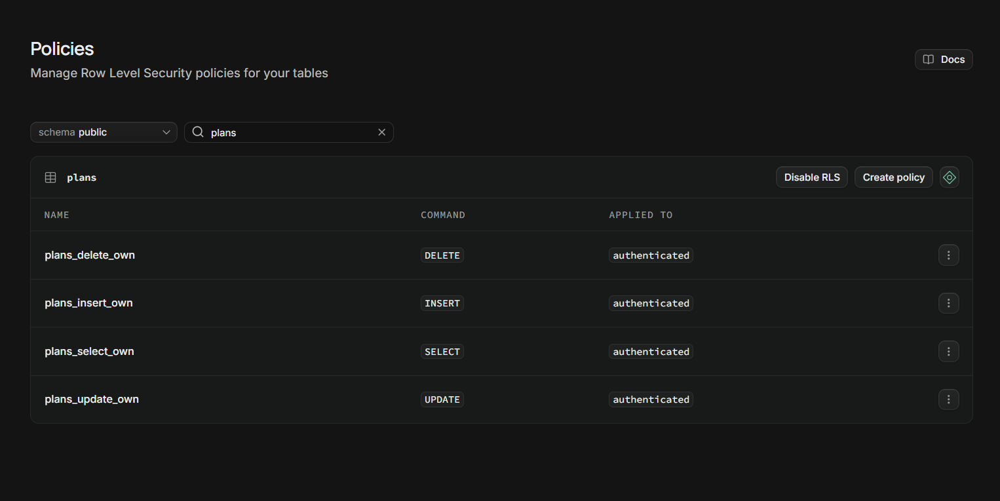

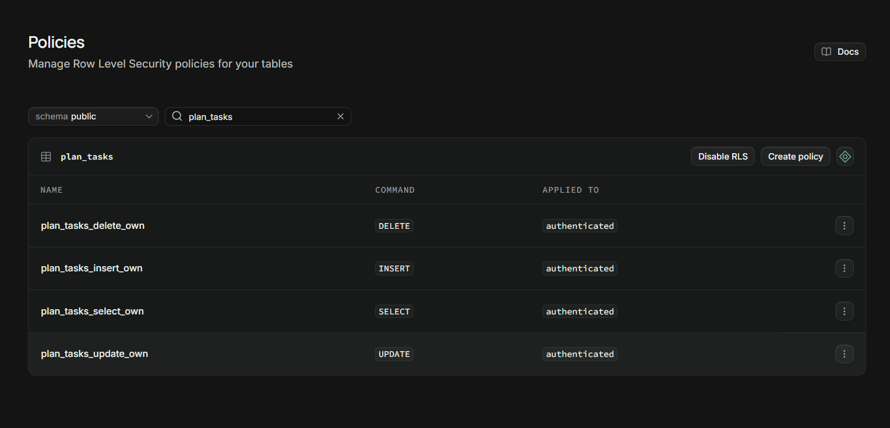

### Automated Testing

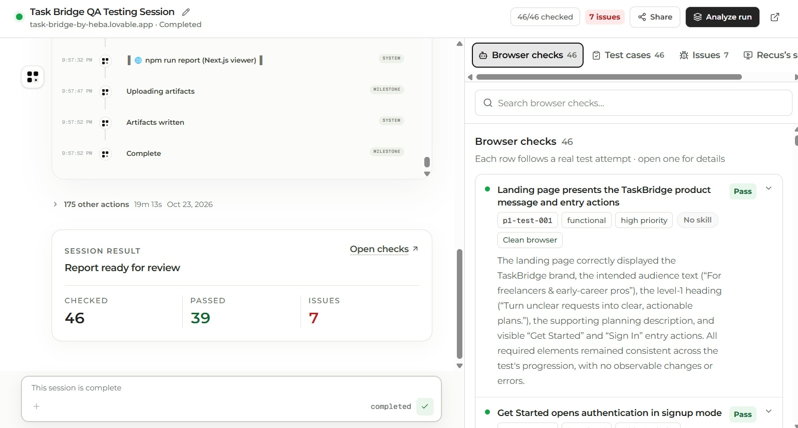

### Performance Audit

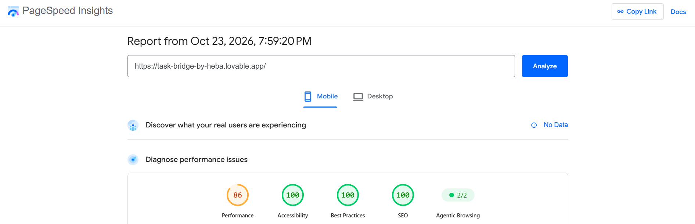

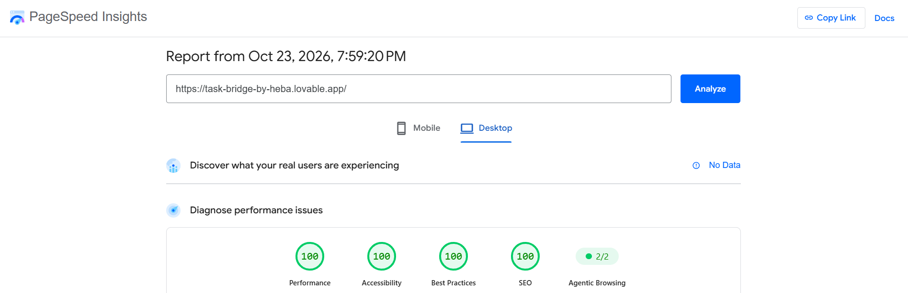

---

## ⚠️ Challenges & Failures

### What Didn't Work as Expected?

- Repeated signup attempts encountered `email rate limit exceeded`, preventing some registration test cases from reaching their expected outcomes.
- Recus reported a possible issue with repeated activation of the Sign up button while a request was pending.
- Some keyboard-navigation and accessible-label checks did not collect enough evidence to determine whether the requirements were satisfied.
- Refreshing the browser while offline displayed the browser's network error rather than a TaskBridge-specific offline message.

### How Did I Respond?

- Distinguished confirmed manual-test results from automated checks requiring further investigation.
- Inspected the database tables and RLS policies in Supabase.
- Used PageSpeed Insights to compare mobile and desktop quality metrics.
- Documented unresolved issues instead of claiming that every test had passed.

---

## 📚 What I Learned

### Technical Lesson

A reliable application requires more than a functional interface. Data relationships, persistence, authentication, validation, and database-level access policies must work together.

### Problem-Solving Lesson

A failed test is a signal to investigate, not automatically proof of a bug. Comparing expected and actual behavior helps identify root causes and avoid unnecessary changes.

### AI Lesson

AI-assisted development and browser testing can accelerate implementation and identify potential issues, but their outputs must be checked against real application behavior and supporting evidence.

---

## 🔮 Future Improvements

If I continued developing TaskBridge, I would:

- Improve mobile performance by investigating render-blocking resources and unused JavaScript.
- Verify keyboard navigation and accessible labels through targeted accessibility tests.
- Review signup submission handling and improve authentication error feedback.
- Improve the application's behavior during network interruptions.
- Expand automated regression tests for core plan and task workflows.

---

## 🔗 Project Links

**Live Demo:** [TaskBridge](https://task-bridge-by-heba.lovable.app)

**Workflow and Testing Evidence:** [Recus Shared Run](https://www.recus.app/shared/runs/bzy9auqydGz7IlQaBDbVAmYV3oWqeK3nN41RkaH-DDI)

**Repository:** [Open GitHub Repository](https://github.com/heba-nedal/task-bridge.git).

---

## 👩‍💻 Author

**Heba Nedal**

[LinkedIn](https://www.linkedin.com/in/heba-n-ismail-b836b2377/) · [GitHub](https://github.com/heba-nedal)
