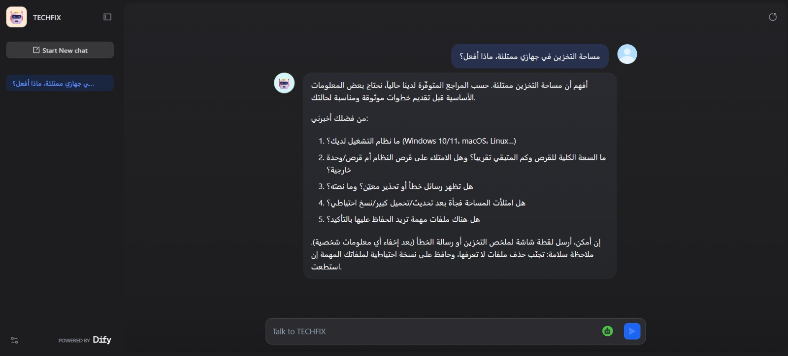
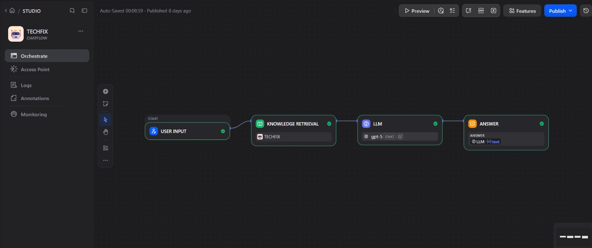
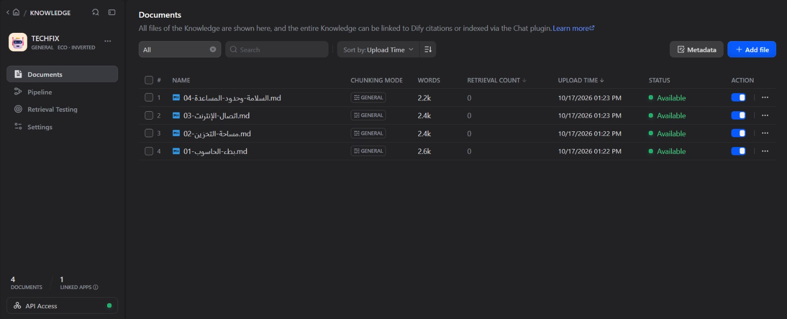

# TECHFIX — AI Computer Troubleshooting Assistant

> An Arabic AI assistant that helps users troubleshoot common computer problems using a specialized knowledge base and Retrieval-Augmented Generation (RAG).

---

## 🎯 Problem

### The Context

Many computer users encounter technical problems such as slow performance, insufficient storage space, and internet connectivity issues. They may struggle to understand the causes or identify appropriate troubleshooting steps, especially when technical guidance is difficult to understand or unsuitable for their situation.

### The Problem

General-purpose AI assistants may generate generic, incomplete, or unsupported troubleshooting advice. A convincing answer does not necessarily mean that the information is accurate or supported by reliable sources.

TECHFIX addresses this challenge by connecting an AI assistant to a specialized knowledge base and using retrieved information to guide its responses.

### Why It Matters

- Makes technical guidance more accessible to Arabic-speaking users.
- Helps users understand common computer problems and possible next steps.
- Reduces reliance on unsupported, generic answers.
- Encourages appropriate handling of missing information and uncertainty.
- Promotes safer troubleshooting and recognizes when professional assistance may be necessary.

---

## 💡 Solution

TECHFIX is an Arabic-language AI troubleshooting assistant built with Dify. It uses Retrieval-Augmented Generation (RAG) to retrieve relevant information from a specialized knowledge base before generating a response.

What does the system do?

1. Receives the user's question and description of a computer problem.
2. Retrieves relevant information from the knowledge base.
3. Uses the retrieved context, user question, and system instructions to generate a response.
4. Provides initial troubleshooting guidance, requests additional details when necessary, or acknowledges insufficient knowledge when appropriate.

The initial scope covers computer performance, storage space, internet connectivity, and safety guidelines.

---

## 👤 Users

**Primary Users:**

Arabic-speaking computer users who need initial guidance for common computer problems.

**User Need:**

Understand the problem they are experiencing, receive clear and relevant troubleshooting guidance, and recognize when more information or professional technical assistance is needed.

---

## 🧠 How I Designed the Solution

I began by defining the problem, the assistant's scope, and the type of guidance it should provide.

Instead of relying only on the language model's general knowledge, I organized the information into four specialized Markdown documents, each covering a specific troubleshooting area.

The design focuses on:

- **Defined Scope:** Limiting the assistant to the topics covered by its knowledge base.
- **Knowledge Organization:** Structuring information into focused documents to support relevant retrieval.
- **Grounding:** Using retrieved context to inform generated responses.
- **Controlled Behavior:** Defining the assistant's role and response rules through a System Prompt.
- **Safety and Uncertainty:** Avoiding unsupported advice and handling insufficient information appropriately.
- **Evidence-Based Improvement:** Evaluating retrieval and answer quality separately to identify potential failure points.

The objective is not simply to generate answers, but to build an assistant whose responses can be tested and improved.

---

## ⚙️ How It Works

```text
User Question
      ↓
Knowledge Retrieval
      ↓
Relevant Context
      ↓
LLM + System Instructions
      ↓
Troubleshooting Guidance
```

The Dify Chatflow consists of four main components:

1. **User Input:** Receives the user's question.
2. **Knowledge Retrieval:** Searches the specialized knowledge base for relevant information.
3. **LLM:** Generates a response using the question, retrieved context, and system instructions.
4. **Answer:** Returns the generated response to the user.

Retrieving relevant information does not guarantee that the final answer will be correct or complete. Both retrieval quality and answer quality must be evaluated.

---

## 🤖 Role of AI

What does AI do in this solution?

- Interprets the user's question and computer problem description.
- Uses retrieved knowledge to formulate relevant troubleshooting guidance.
- Organizes information into a clear, understandable response.
- Requests clarification when additional information is needed, according to its instructions.
- Acknowledges the limits of available knowledge when appropriate.

### What AI Should NOT Do

- Invent information or troubleshooting steps unsupported by available knowledge.
- Confirm the cause of a problem without sufficient information.
- Assume that relevant retrieval results automatically make the final answer correct.
- Recommend potentially harmful actions without appropriate safety considerations.
- Claim to inspect the user's computer directly or execute repairs.
- Present unsupported answers with unwarranted confidence.

---

## 🔄 Automation

What parts of the process are automated?

- Receiving the user's question through the application.
- Retrieving relevant information from the knowledge base.
- Passing retrieved context to the language model.
- Generating a response based on the question, context, and instructions.
- Passing information between workflow components through Dify Chatflow.

Testing, reviewing failures, and deciding which improvements to implement remain separate evaluation and development activities.

---

## 🗂️ Data

### Input

The system uses:

- The user's question and description of the computer problem.
- Four specialized Markdown documents stored in the knowledge base.
- System instructions defining the assistant's role, scope, and response behavior.
- Relevant context retrieved from the knowledge base.

The knowledge base contains:

| Document | Content |
|---|---|
| `01-بطء-الحاسوب.md` | Computer performance problems, possible causes, and troubleshooting steps. |
| `02-مساحة-التخزين.md` | Storage-space problems, checking available space, and freeing storage. |
| `03-اتصال-الإنترنت.md` | Internet connectivity problems and initial troubleshooting guidance. |
| `04-السلامة-وحدود-المساعدة.md` | Safety guidelines, warnings, assistant limitations, and cases requiring professional help. |

### Output

The system generates an Arabic response containing initial troubleshooting guidance based on the user's question and the available retrieved information.

Depending on the situation, the intended behavior also includes requesting additional details, acknowledging insufficient knowledge, or recommending professional assistance.

---

## 🛠️ Tools & Technologies

| Tool | Purpose |
|---|---|
| Dify | Building and configuring the AI application. |
| Knowledge Base | Storing and organizing specialized troubleshooting documents. |
| Retrieval-Augmented Generation (RAG) | Connecting answer generation to retrieved knowledge. |
| Knowledge Retrieval | Finding information relevant to the user's question. |
| Large Language Model (LLM) | Generating responses using the question, instructions, and retrieved context. |
| Chatflow | Organizing the workflow between application components. |
| System Prompt | Defining the assistant's role, behavior, and response constraints. |
| Markdown | Authoring knowledge documents and project documentation. |
| GitHub | Versioning and sharing project documentation and supporting files. |

---

## 🔑 Key Design Decisions

### Decision 1 — Use a Specialized Knowledge Base

**Decision:**

Organize the assistant's knowledge into four specialized Markdown documents instead of relying exclusively on the language model's general knowledge.

**Why:**

A structured knowledge base helps define the assistant's scope, organize information by topic, and retrieve relevant content. It also makes the knowledge easier to review, maintain, and improve.

### Decision 2 — Evaluate Retrieval and Answer Quality Separately

**Decision:**

Treat retrieval quality and final answer quality as two separate evaluation stages.

**Why:**

Initial testing showed that relevant information could be retrieved without producing a sufficiently detailed final answer. In one internet-connectivity test, the response was limited despite retrieving results from the relevant knowledge document.

This demonstrates why a failure should be investigated before changing the system. The issue may involve the knowledge content, retrieval results, retrieved context, or the model's use of that context.

---

## 🧪 Testing

Testing focused on evaluating the assistant's ability to retrieve relevant knowledge, respond appropriately to user questions, handle missing information, and avoid unsupported technical instructions.

### Test 1 — Internet Connectivity Troubleshooting

**Input:**

The user reports that the computer is connected to Wi-Fi but cannot access websites. The user asks about possible causes and troubleshooting steps.

**Expected Result:**

The assistant should check whether the available knowledge base covers the reported issue. If the sources do not provide sufficient guidance, it should acknowledge this limitation, ask relevant clarifying questions, and avoid inventing troubleshooting steps.

**Actual Result:**

The assistant explained that the available reference covered a Wi-Fi network not appearing, rather than a device connected to Wi-Fi but unable to access the internet. It asked relevant questions about the affected websites, other applications and devices, VPN or proxy usage, and previous connection attempts. It clearly stated that more information was needed before recommending a suitable next step.

**Status:** Passed — The assistant recognized the limits of the available information, asked relevant clarifying questions, and avoided unsupported technical instructions.

### Test 2 — Handling a Problem Beyond the Knowledge Base

**Input:**

The user reports that a Windows 11 computer displays "Connected, no internet" across multiple networks, including a mobile hotspot. Other devices work normally, and the issue began immediately after installing a new network management program.

**Expected Result:**

The assistant should use the information provided during the conversation to narrow down possible causes, acknowledge when the knowledge base lacks verified instructions for the specific issue, and provide safe guidance without presenting an unverified diagnosis as fact.

**Actual Result:**

The assistant identified a possible connection between the newly installed program and the network issue, while explicitly stating that the cause was not confirmed. It acknowledged that the available knowledge base lacked sufficient documented instructions for this particular scenario and recommended contacting the software provider or a qualified technician. It also warned against potentially risky system changes.

**Status:** Passed — The assistant respected the knowledge base limitations, handled uncertainty appropriately, and avoided unsupported technical instructions.

### Testing Summary

The tests demonstrated that TECHFIX could recognize when the available knowledge was insufficient, ask relevant follow-up questions, use information from previous turns, and avoid presenting speculative causes as confirmed diagnoses.

The second test also highlighted an opportunity to expand the knowledge base with verified guidance for additional Windows network connectivity problems.

These results evaluate the assistant's observed responses in the tested scenarios. They do not establish that every response is fully grounded in retrieved sources or that all troubleshooting scenarios are covered.

---

## 📸 Evidence

### Final Result

The assistant responds in Arabic to a storage-space question, requests additional diagnostic details, and provides a safety reminder.



### Workflow

The Dify Chatflow connects user input, knowledge retrieval, the language model, and the final answer.



### Knowledge Base

The knowledge base contains four specialized Markdown documents covering computer performance, storage, internet connectivity, and safety guidelines.



These screenshots document the application's structure and an example interaction. They do not independently establish the overall accuracy or reliability of the system.

---

## ⚠️ Challenges & Failures

What didn't work as expected?

- Some responses were less detailed or complete than expected.
- Relevant retrieval results did not always lead to sufficiently complete answers.
- Initial tests did not provide comprehensive, individually documented evidence of performance across all scenarios.
- Retrieval quality and answer quality required separate evaluation.

How did I approach these challenges?

- Separated retrieval evaluation from final-answer evaluation.
- Identified possible failure points before deciding on improvements.
- Recognized the need to review knowledge content, retrieval results, context, and system instructions.
- Defined a testing and iteration process for evaluating future changes.

These are the documented findings and improvement approach; they do not imply that every identified limitation has already been resolved.

---

## 📚 What I Learned

### Technical Lesson

I learned how to build a knowledge-grounded AI assistant using Dify, a specialized knowledge base, retrieval, and a language model.

I also learned that system performance depends on the quality and organization of the knowledge sources, retrieval configuration, retrieved context, and answer generation.

### Problem-Solving Lesson

I learned that an incorrect or incomplete response does not necessarily have a single cause.

A systematic investigation is needed to identify the likely failure point before making changes. Retesting is then necessary to determine whether an improvement actually addresses the problem.

### AI Lesson

I learned that a convincing AI-generated answer is not necessarily accurate or supported by available sources.

Building a reliable assistant requires attention to grounding, retrieval quality, answer completeness, uncertainty handling, and safety. Recognizing when information is insufficient is an important part of responsible AI behavior.

---

## 🔮 Future Improvements

If I continued developing this project, I would:

- Build a structured test set covering direct, paraphrased, incomplete, out-of-scope, and safety-related questions.
- Evaluate retrieval relevance and the sufficiency of retrieved context.
- Assess answers for correctness, groundedness, completeness, clarity, and safety.
- Improve the knowledge documents, chunking, and retrieval settings based on observed failures.
- Refine the System Prompt to improve the use of retrieved information and the handling of uncertainty.
- Document expected and actual results before and after changes.
- Expand the knowledge base using reliable, documented sources.
- Add clearer source attribution to responses if supported by the application configuration.

---

## 🔗 Project Links

**Live Demo:** [Try TECHFIX](https://udify.app/chat/PsJmWRsJWLrFVzjv)

**Workflow:** [View the workflow screenshot](./Screenshots/workflow.png)

**Repository:** [TECHFIX on GitHub](https://github.com/heba-nedal/TECHFIX)

---

## 👩‍💻 Author

**Heba Nedal**

[LinkedIn](https://www.linkedin.com/in/heba-n-ismail-b836b2377/) · [GitHub](https://github.com/heba-nedal)
