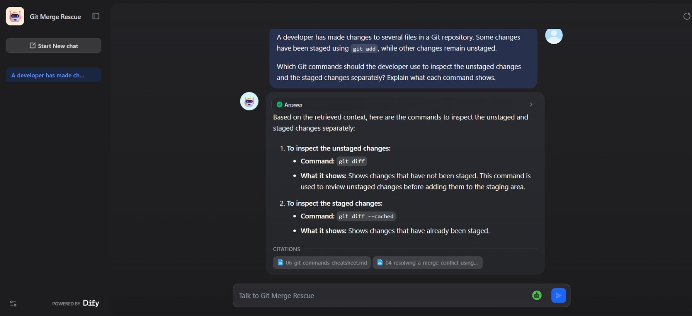
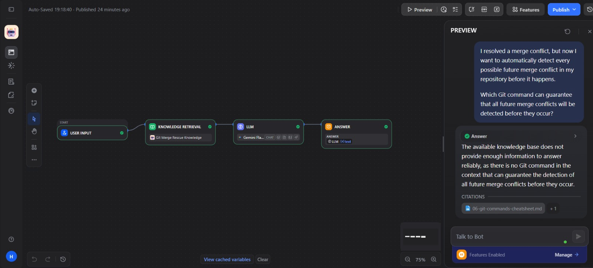

# Git Merge Rescue — Knowledge Assistant

> A knowledge-grounded AI assistant that helps developers understand Git merge conflicts and provides answers based on a curated technical knowledge base.

---

## 🎯 Problem

### The Context

Git developers often work with feature branches, pull requests, and collaborative code changes. When Git cannot automatically combine changes from different branches, a merge conflict occurs and requires the developer to inspect and resolve the conflicting content.

Understanding which command to use, how to verify changes, and how to complete a merge safely can be challenging, especially when the correct action depends on the repository's current state.

### The Problem

Developers need reliable, context-specific guidance for Git merge conflicts. General AI responses may provide commands or explanations that are not supported by the available documentation or may fail to distinguish between resolving conflicts and completing a pull request.

### Why It Matters

Incorrect merge operations can lead to unintended changes, incomplete workflows, or confusion about the state of a repository. A knowledge-grounded assistant can help developers find relevant guidance while acknowledging when the available documentation does not support a reliable answer.

---

## 💡 Solution

Git Merge Rescue is a Retrieval-Augmented Generation (RAG) application built with Dify. It uses a curated knowledge base of six Markdown documents about Git branches, pull requests, merge conflicts, and related commands.

What does the system do?

1. Receives a user's question about Git or merge conflicts.
2. Retrieves relevant passages from the knowledge base using a configured retrieval pipeline.
3. Uses the retrieved context to generate a relevant answer.
4. Acknowledges insufficient knowledge when the available context does not support a reliable answer.

---

## 👤 Users

**Primary Users:**  
Developers and learners who use Git and GitHub and need guidance on branches, pull requests, merge conflicts, and related commands.

**User Need:**  
Understand Git conflict-resolution procedures, inspect repository changes, choose appropriate next steps, and distinguish between resolving conflicts and merging a pull request.

---

## 🧠 How I Designed the Solution

I designed the system around a specific technical knowledge domain rather than relying on general-purpose conversational answers.

The knowledge base contains six Markdown documents covering complementary topics:

- Pull requests
- Git branches
- Merge conflicts
- Resolving merge conflicts using the command line
- Resolving merge conflicts on GitHub
- Git command reference and troubleshooting guidance

I configured the Dify knowledge pipeline to use High Quality indexing, the `gemini-embedding-001` embedding model, Hybrid Search, and the `qwen3-rerank` reranking model, with Top K set to 4.

I also evaluated the system using questions with known answers, questions requiring information from multiple documents, and questions that could not be reliably answered from the available knowledge.

The objective was to assess not only whether the system could answer questions, but also whether its answers were supported by the retrieved information and whether it could acknowledge knowledge limitations.

---

## ⚙️ How It Works

```text
User Question
      ↓
Dify Application
      ↓
Knowledge Retrieval
(Hybrid Search)
      ↓
Reranking
      ↓
Relevant Context
      ↓
LLM Answer Generation
      ↓
Grounded Answer or
Knowledge-Limitation Response
```

---

## 🤖 Role of AI

What does AI do in this solution?

- Interprets the user's question and generates a relevant response.
- Uses retrieved knowledge passages as context for answering.
- Combines related information when the available context supports the answer.
- Acknowledges insufficient information when the knowledge base does not support a reliable response.

### What AI Should NOT Do

- Invent Git commands or procedures that are not supported by the available knowledge.
- Claim that a command is safe in every situation without supporting evidence.
- Present an unsupported answer as a verified fact.
- Assume the repository's current state when the appropriate action depends on that state.

---

## 🔄 Automation

What parts of the process are automated?

- Retrieving relevant knowledge passages in response to a user's question.
- Ranking retrieved passages using the configured reranking component.
- Passing retrieved context to the language model.
- Generating an answer based on the available context.
- Responding to questions that lack sufficient supporting information by acknowledging the knowledge limitation.

The application automates knowledge retrieval and answer generation. It does not execute Git commands or modify the user's repository.

---

## 🗂️ Data

### Input

- User questions about Git branches, pull requests, merge conflicts, and Git commands.
- Six curated Markdown documents used as the knowledge source.
- Retrieved passages selected by the configured retrieval pipeline.

### Output

- Natural-language answers grounded in the retrieved context.
- Git command explanations and documented troubleshooting guidance.
- Responses acknowledging when the available knowledge is insufficient.
- Evaluation evidence collected from actual test questions and retrieval results.

---

## 🛠️ Tools & Technologies

| Tool | Purpose |
|---|---|
| Dify | Build the knowledge base and AI application |
| Markdown | Store and organize technical knowledge documents |
| Hybrid Search | Retrieve relevant knowledge passages |
| `gemini-embedding-001` | Generate embeddings for semantic retrieval |
| `qwen3-rerank` | Rerank retrieved passages |
| Gemini LLM | Generate answers using the available context |
| Git & GitHub Documentation | Provide the technical knowledge used by the assistant |

---

## 🔑 Key Design Decisions

### Decision 1 — Use a Curated Knowledge Base

**Decision:**  
Use six focused Markdown documents covering Git branches, pull requests, merge conflicts, and relevant commands.

**Why:**  
The assistant needs a defined and reviewable knowledge source so its responses can be evaluated against the documented information.

### Decision 2 — Use Hybrid Search and Reranking

**Decision:**  
Configure Hybrid Search with reranking and Top K set to 4.

**Why:**  
The retrieval pipeline is intended to identify relevant passages from the knowledge base before the language model generates an answer.

### Decision 3 — Evaluate Knowledge Boundaries

**Decision:**  
Include questions whose answers are unavailable in the knowledge base.

**Why:**  
A knowledge-grounded system should recognize when the available evidence is insufficient instead of inventing commands, guarantees, or procedures.

### Decision 4 — Inspect Actual Retrieval Results

**Decision:**  
Review retrieved passages and their relevance scores when investigating an incomplete answer.

**Why:**  
This helps distinguish a possible retrieval limitation from an answer-generation limitation without assuming that every failure has the same cause.

---

## 🧪 Testing

Ten questions were tested in Dify. The following examples summarize two of the actual test cases.

### Test 1 — Completing a Merge

**Input:**  
Should a developer run both `git merge --continue` and `git commit` after all merge conflicts have been resolved and staged?

**Expected Result:**  
The system should explain that these commands are alternatives in the appropriate repository state and should not both be run simply to finish the same merge.

**Actual Result:**  
The system explained the purpose of both commands, recommended selecting the appropriate one, and explicitly warned against running both.

**Status:** ✅ PASS

---

### Test 2 — Integrating Information Across Multiple Documents

**Input:**  
Explain how to inspect the repository state, review staged changes, complete a merge, push the result when appropriate, and distinguish conflict resolution from merging a pull request.

**Expected Result:**  
The system should explain the documented Git workflow and clarify that resolving conflicts does not automatically mean that the pull request has been merged into its base branch.

**Actual Result:**  
The system correctly explained the repository checks, staged-change review, merge completion, and push steps. However, it did not fully explain the distinction between resolving conflicts and completing the pull request merge in its initial response. A later retest improved the explanation but still did not fully address the distinction.

**Status:** ⚠️ PARTIAL PASS

**Additional Evaluation:**  
Other tests showed that the system could correctly explain the difference between resolving conflicts and merging a pull request when that concept was asked about directly. The initial partial failure was retained as an evaluation finding rather than treated as a fully resolved issue.

**Full Test Results:**  
See [`TEST_CASES.md`](./TEST_CASES.md).

---

## 📸 Evidence

### Final Result



### Workflow



---

## ⚠️ Challenges & Failures

What didn't work as expected?

- A multi-part question was answered incompletely even though the retrieved context contained information related to pull requests.
- The retrieved context did not always include the most explicit explanation needed to answer every part of a question.
- During testing, the Gemini provider returned a temporary `503 UNAVAILABLE` error indicating high demand. This prevented answer generation during that attempt and was not evidence of a retrieval failure.

How did I handle these issues?

- Inspected actual retrieval results and their relevance scores.
- Compared the incomplete response with the relevant knowledge documents.
- Retested the multi-part question and recorded the result rather than assuming the issue was fully resolved.
- Kept the retrieval configuration unchanged because the observed results did not provide sufficient evidence to justify a configuration change.
- Recorded the temporary provider error separately from the knowledge-grounding evaluation.

No additional retrieval configuration changes were made based on these tests.

---

## 📚 What I Learned

### Technical Lesson

A RAG application's answer quality depends on the knowledge documents, chunking, retrieval pipeline, retrieved context, and language-model generation. The presence of information in a source does not guarantee that the correct passage will be retrieved or fully used in an answer.

### Problem-Solving Lesson

When an answer is incomplete, inspect the retrieved context before changing settings. Evidence from the retrieval stage helps narrow down the potential cause and prevents unnecessary configuration changes.

### AI Lesson

A reliable knowledge assistant must do more than generate plausible answers. It should ground its responses in available evidence, recognize knowledge limitations, and avoid unsupported claims. Evaluation must include both successful answers and observed failures.

---

## 🔮 Future Improvements

If I continued developing this project, I would:

- Expand the evaluation dataset with additional multi-document and indirect questions.
- Compare retrieval results across different question formulations.
- Add more targeted tests for cases where relevant information exists but the generated answer is incomplete.
- Capture and organize screenshots of the application, retrieval results, and workflow.
- Reevaluate retrieval settings only if further tests provide evidence that changes are needed.

---

## 🔗 Project Links

**Live Demo:** [Try Git Merge Rescue](https://udify.app/chat/A1YrBzRDu6Unq38V)

**Workflow:** [View the workflow screenshot](./Screenshots/workflow.png)

---

## 👩‍💻 Author

**Heba Nedal**

[LinkedIn](https://www.linkedin.com/in/heba-n-ismail-b836b2377/) · [GitHub](https://github.com/heba-nedal)
