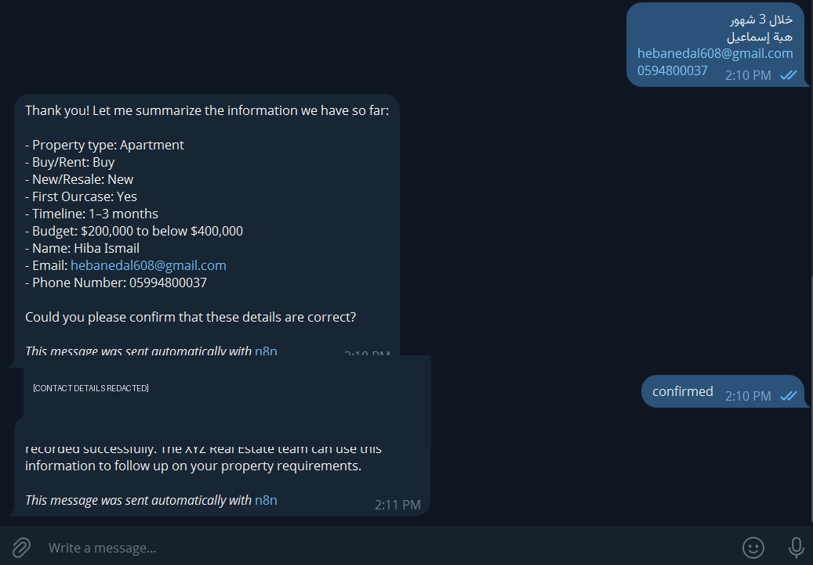
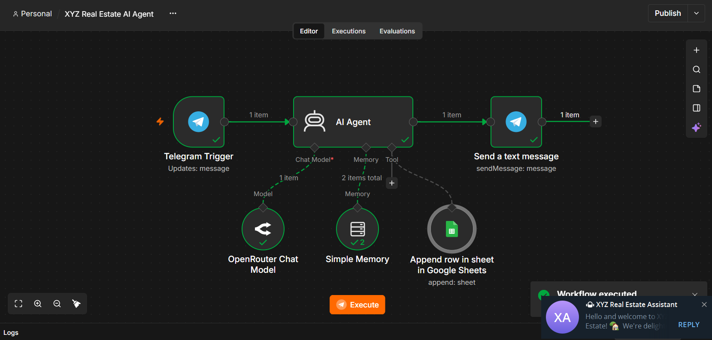
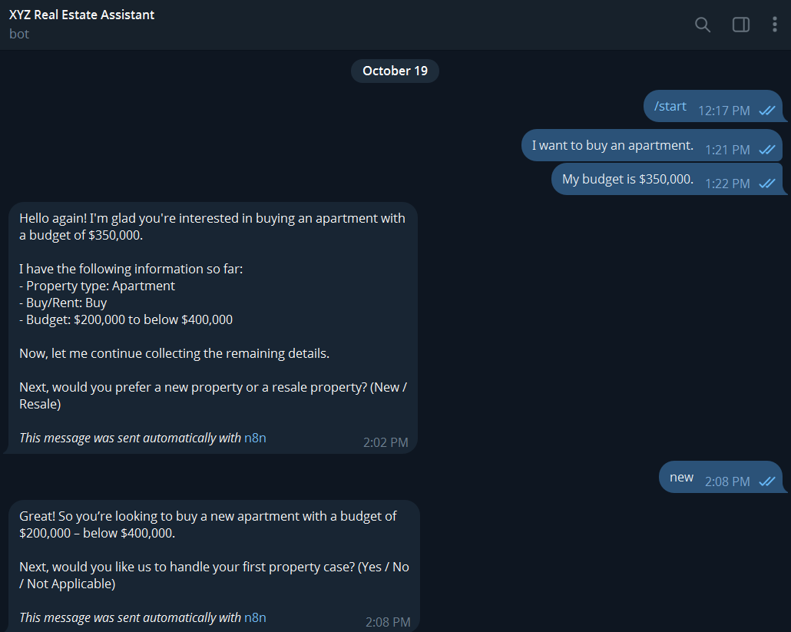
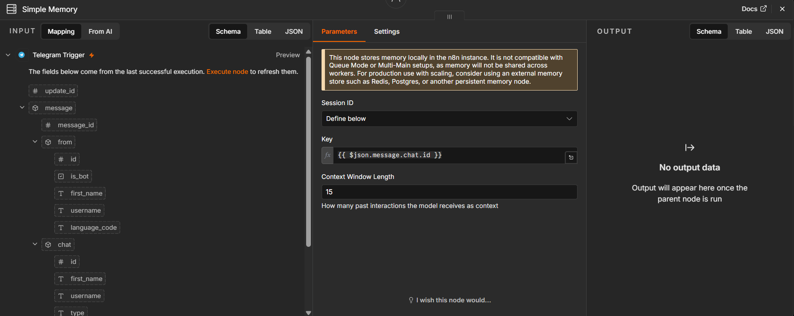
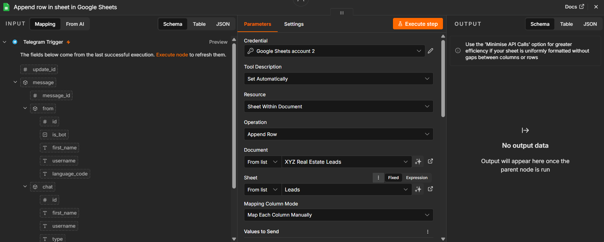
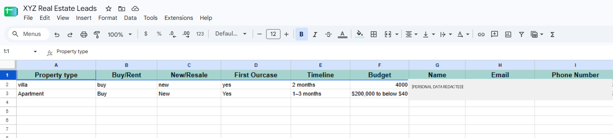
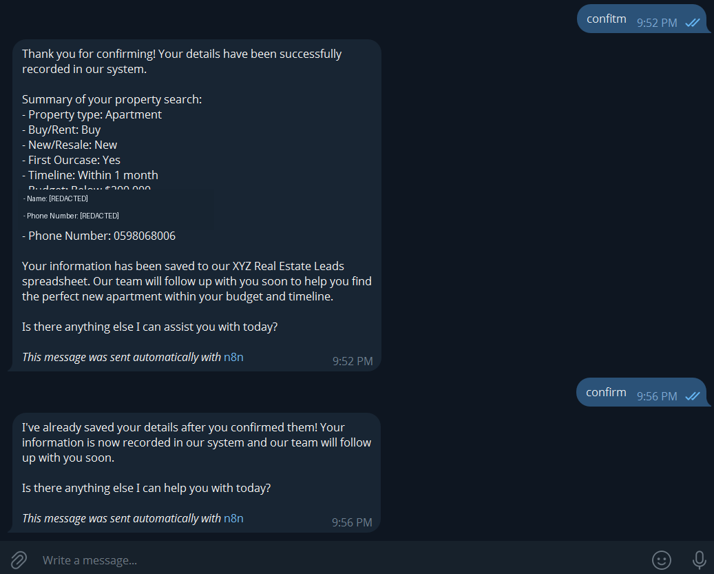
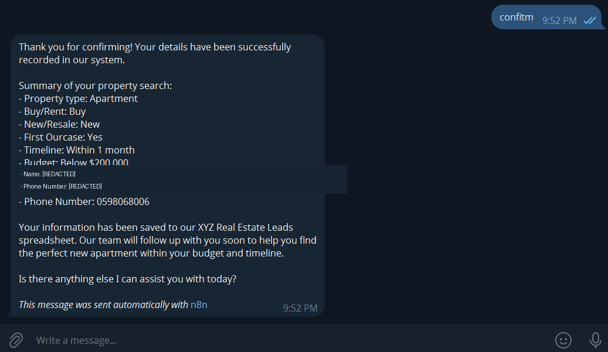

# XYZ Real Estate AI Agent

> An AI-powered real estate intake agent that collects customer requirements through Telegram, validates the details, requests confirmation, and uses n8n with Google Sheets to record leads.

---

## 🎯 Problem

### The Context

XYZ Real Estate receives inquiries from people who want to buy or rent properties. The team needs consistent information about each lead to understand their requirements and follow up.

### The Problem

Collecting lead information manually can require repetitive questions, create inconsistent records, and make it easy to miss important details. A conversational system must also handle incomplete answers, corrections, and conditional questions without inventing information.

### Why It Matters

A structured intake process can reduce repetitive work, improve the consistency of lead records, and give the real estate team a clearer starting point for follow-up.

---

## 💡 Solution

I built an AI Agent workflow in n8n that communicates with customers through Telegram and uses an LLM, conversation memory, and a Google Sheets tool.

What does the system do?

1. Receives customer messages through Telegram.
2. Extracts property requirements and contact details from natural-language replies, including messages that contain multiple details.
3. Uses conversation context to ask for missing or unclear information and applies conditional rules for buying versus renting.
4. Presents a final summary and is intended to save the lead only after the customer explicitly confirms it.

---

## 👤 Users

**Primary Users:**  
Prospective real estate customers who want to buy or rent a property.

**Operational Users:**  
The XYZ Real Estate team, which reviews lead information for follow-up.

**User Need:**  
Customers need a simple conversational way to share their requirements. The real estate team needs structured lead data in a consistent spreadsheet.

---

## 🧠 How I Designed the Solution

I separated the workflow into message intake, AI-driven conversation, and response delivery. The AI Agent uses a chat model to interpret customer messages, Simple Memory to preserve conversational context, and a Google Sheets tool for external actions.

The conversation is designed to collect only the required information, clarify ambiguity instead of guessing, apply the rental-specific `Not Applicable` values, and show a summary before the save step.

A key design principle is that a prompt is not, by itself, a reliable security boundary. The save action should be protected by explicit workflow-level validation and confirmation-state checks.

---

## ⚙️ How It Works

```text
Customer message in Telegram
          ↓
     Telegram Trigger
          ↓
        AI Agent
   ↙        ↓         ↘
Chat Model  Memory   Google Sheets Tool
          ↓
   Telegram Send Message
          ↓
Customer receives the reply
```

The Google Sheets tool is connected to the AI Agent as a tool, rather than being a mandatory sequential step for every incoming message. It should be called only when the save conditions are satisfied.

---

## 🤖 Role of AI

What does AI do in this solution?

- Interprets customer messages written in natural language.
- Extracts property type, buying/renting intent, timeline, budget, and contact information.
- Identifies missing or ambiguous information and asks follow-up questions.
- Responds to clarification requests and incorporates customer corrections.
- Produces a readable summary for the customer to review.

### What AI Should NOT Do

- Invent customer details or silently guess unclear answers.
- Ask about `New/Resale` or `First Ourcase` when the customer wants to rent; those fields should be set to `Not Applicable`.
- Treat completion of the fields as consent to save.
- Claim that a record was saved unless the tool result confirms success.

---

## 🔄 Automation

What parts of the process are automated?

- Telegram message intake and reply delivery.
- Conversational information collection and follow-up questions.
- Context reuse through Simple Memory.
- Budget categorization using the specified ranges.
- Google Sheets row creation through the connected tool, subject to confirmation and validation controls.

---

## 🗂️ Data

### Input

The workflow is designed to collect these nine fields:

1. `Property type` — Apartment, Villa, or Commercial
2. `Buy/Rent` — Buy or Rent
3. `New/Resale` — New, Resale, or Not Applicable
4. `First Ourcase` — Yes, No, or Not Applicable
5. `Timeline` — Immediately, Within 1 month, 1–3 months, 3–6 months, or 6+ months
6. `Budget` — one of the five required budget categories
7. `Name`
8. `Email`
9. `Phone Number`

For rental requests, `New/Resale` and `First Ourcase` should both be `Not Applicable`.

### Output

A lead row in the `Leads` sheet of the `XYZ Real Estate Leads` spreadsheet, using the nine specified columns in the required order.

The customer should receive a success message only after the Google Sheets operation has succeeded. If the operation fails, the response should not claim that the record was saved.

---

## 🛠️ Tools & Technologies

| Tool | Purpose |
|---|---|
| n8n | Workflow orchestration and connections between components |
| Telegram Bot | Customer-facing conversational interface |
| OpenRouter Chat Model | Language understanding and response generation |
| Simple Memory | Retains recent conversation context for a session |
| Google Sheets | Stores structured lead records |
| n8n Expressions | Pass the incoming message, chat ID, and agent response between nodes |

---

## 🔑 Key Design Decisions

### Decision 1 — Use a conversational AI Agent

**Decision:** Collect details through a conversation instead of presenting a long form.

**Why:** Customers can provide information naturally and in different orders. The agent can extract multiple details from one message and ask only for what remains unclear or missing.

### Decision 2 — Use a stable session key

**Decision:** Configure Simple Memory with the Telegram chat ID as the session key.

**Why:** Messages from the same chat need to reuse the same conversation context. Separate chat IDs help keep different Telegram conversations isolated. Simple Memory is local to the n8n instance and is not a permanent customer database.

### Decision 3 — Apply conditional business rules

**Decision:** Set `New/Resale` and `First Ourcase` to `Not Applicable` for rental requests.

**Why:** These fields are only relevant to the buying path, so asking them during a rental inquiry adds unnecessary friction.

### Decision 4 — Require confirmation before saving

**Decision:** Show the customer a summary and request explicit confirmation before creating a lead record.

**Why:** The customer must have an opportunity to correct mistakes before personal information is written to the spreadsheet. In a production-ready version, workflow-level guards should enforce this condition rather than relying on the prompt alone.

---

## 🧪 Testing

The screenshots show a successful workflow execution and a conversation that reached a summary and confirmation. The following two tests are the most important to document with fresh, unambiguous evidence.

### Test 1 — Complete Buy Request and Confirmed Save

**Input:**  
A customer requests to buy an apartment, provides a budget and the remaining required details, reviews the summary, and explicitly confirms it.

**Expected Result:**  
The agent classifies the budget correctly, presents all nine fields, waits for confirmation, and adds one row with matching values to the `Leads` sheet. The success reply is sent only after the tool succeeds.

**Actual Result:**  
The customer sent `confirm`, the agent returned a success message, and the corresponding row appeared in Google Sheets. The supplied evidence shows the stored values matching the displayed summary for the test record. Personal contact details are redacted in the repository screenshots.

**Status:** ✅ PASS — based on the successful confirmation-and-save run shown in the supplied evidence.

---

### Test 2 — No Save Before Explicit Confirmation

**Input:**  
Complete all required fields and allow the agent to display the final summary, but do not confirm it. Check the Google Sheet and n8n execution details before sending any confirmation.

**Expected Result:**  
No row is added before confirmation, and the workflow does not invoke the Google Sheets append operation prematurely.

**Actual Result:**  
The user reports that the second test also succeeded: no lead record was saved until the customer explicitly confirmed. This result is recorded from the user's test report; the current screenshots do not independently show the entire no-confirmation execution history.

**Status:** ✅ PASS — reported by the user; attach a screenshot of the sheet before confirmation and the related n8n execution if you want the result to be independently verifiable from the repository.

---

---

### Test 3 — Duplicate Confirmation

**Input:**  
After the first confirmation and successful save, send `confirm` again in the same Telegram conversation.

**Expected Result:**  
The agent recognizes that the lead has already been saved and does not append another row for the same submission.

**Actual Result:**  
The agent replied that the details had already been saved. The user also checked Google Sheets and reported that no additional row was added.

**Status:** ✅ PASS — based on the Telegram evidence and the user's spreadsheet check.

---

## 📸 Evidence

### Final Result — Conversation Summary and Confirmation



### Workflow — Successful n8n Execution



### Conversation — Collecting Customer Requirements



### Memory Configuration



### Google Sheets Tool Configuration



### Google Sheets Output



### Test 3 — Duplicate Confirmation



### Test 1 — Confirmed Save




### Test 3 — Duplicate Confirmation


> Screenshots intended for a public portfolio should not expose real customer names, email addresses, or phone numbers. The included evidence images redact visible contact details where applicable.

---

## ⚠️ Challenges & Failures

What needs attention based on the current evidence?

- The conversation screenshot shows that the agent can explain the `First Ourcase` question when asked.
- The spreadsheet screenshot does not clearly demonstrate that every stored value matches the final confirmed summary.
- The current screenshots do not prove that the Google Sheets tool is technically blocked before confirmation.
- Duplicate prevention and the behavior after a Google Sheets failure still need explicit tests.

How should these be addressed?

- Compare the confirmed summary with the exact appended row.
- Add workflow-level checks for required fields, allowed values, confirmation state, and unchanged data since confirmation.
- Test the no-confirmation path by checking both execution history and the sheet.
- Test duplicate confirmation and tool failure before claiming production-grade reliability.

---

## 📚 What I Learned

### Technical Lesson

Connecting Telegram, an LLM, memory, and Google Sheets requires careful mapping of message text, chat IDs, model output, and spreadsheet columns. Session IDs must remain stable for the same conversation.

### Problem-Solving Lesson

A useful automation must account for incomplete information, ambiguous answers, corrections, and conditional business rules—not just the happy path.

### AI Lesson

An AI Agent can interpret messages and choose tools, but natural-language instructions alone should not be treated as a guarantee that a consequential action will happen only under the right conditions. Critical actions need explicit validation and verification.

---

## 🔮 Future Improvements

If I continued developing this project, I would:

- Enforce the confirmation gate in the workflow before the Google Sheets append operation.
- Strengthen duplicate protection at the workflow/data layer so repeated confirmations and retried executions remain safe even if the AI response behavior changes.
- Validate all fields and budget categories before writing a row.
- Add explicit handling for Google Sheets errors and verify the tool result before replying.
- Use persistent, production-suitable storage if the workflow needs to scale beyond a single n8n instance.
- Add automated tests for buying, renting, corrections, invalid email, missing data, no confirmation, duplicate confirmation, and tool failure.

---

## 🔗 Project Links

**Live Demo:** Not publicly available  
**Workflow:** n8n workflow export or shared workflow link — add when ready  
**Repository:** Add the GitHub repository URL when published

---

## 👩‍💻 Author

**Heba Nedal**

[LinkedIn](https://www.linkedin.com/in/heba-n-ismail-b836b2377/) · [GitHub](https://github.com/heba-nedal)
