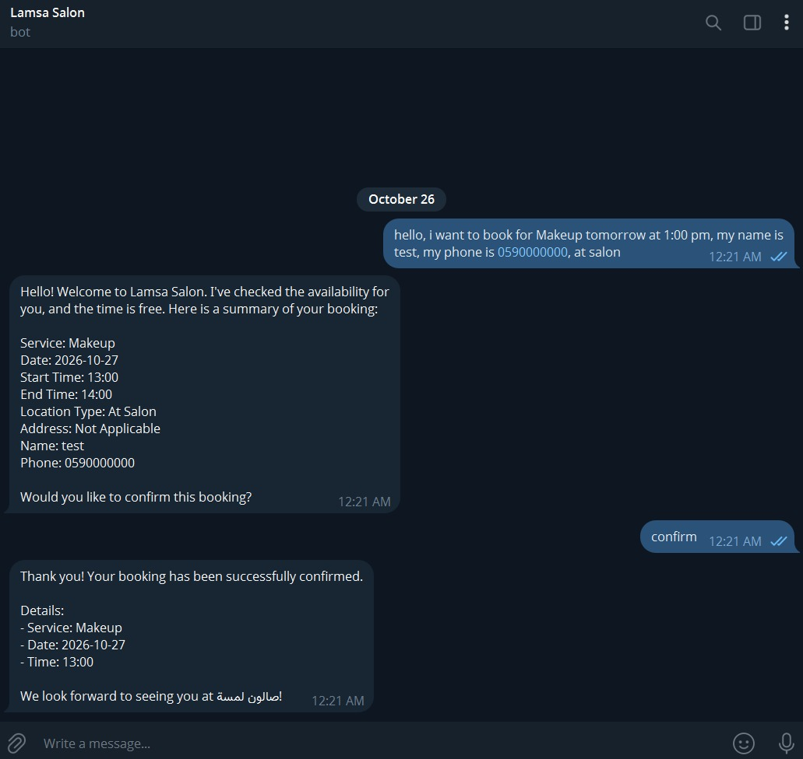
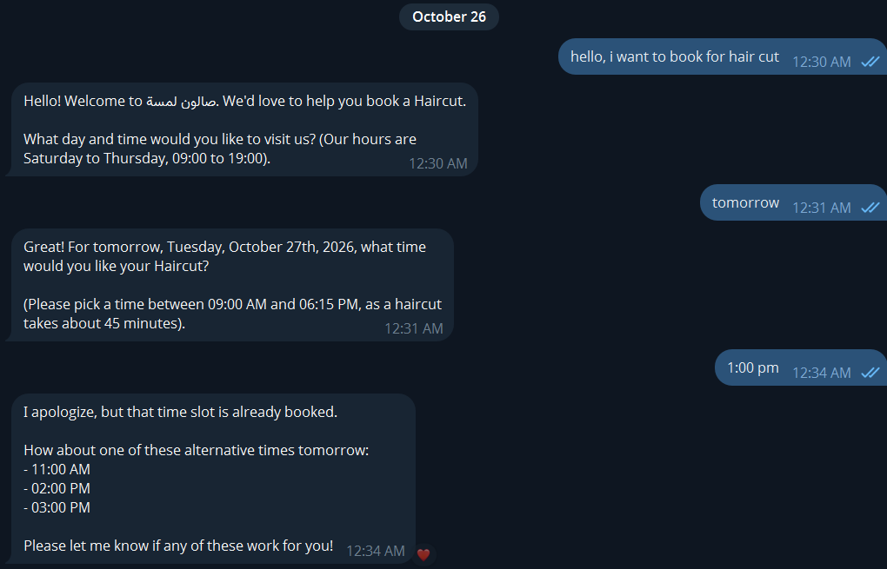
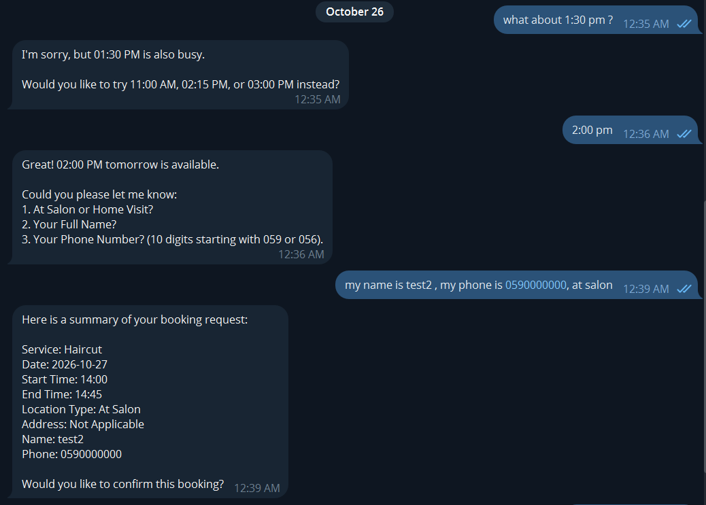
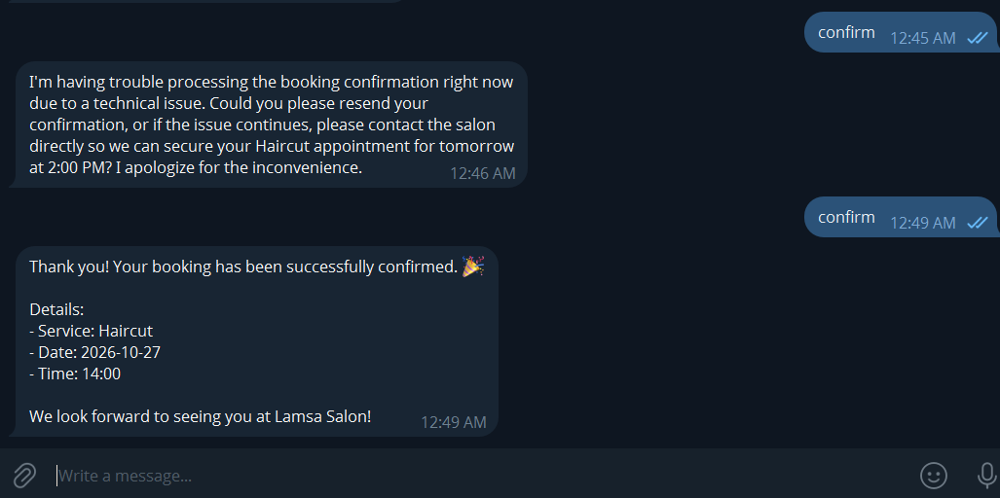
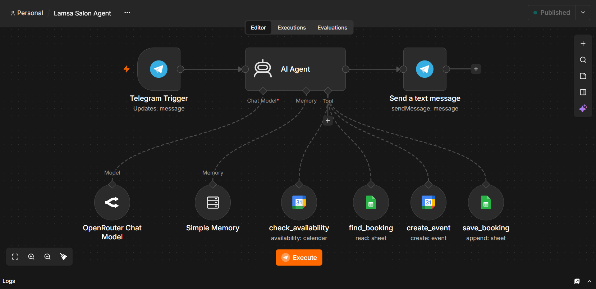
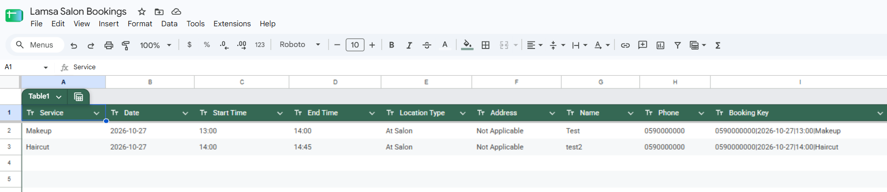
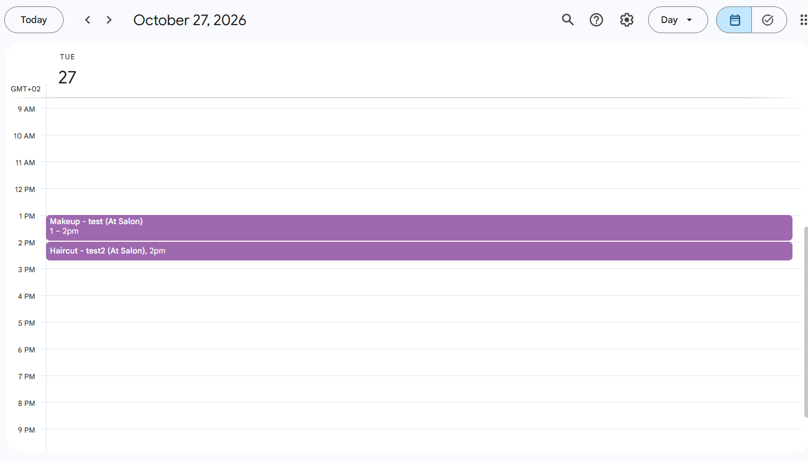

# Lamsa Salon AI Booking Agent

> An AI-powered salon booking assistant that checks appointment availability, guides customers through booking, and records confirmed appointments in Google Calendar and Google Sheets.

---

## 🎯 Problem

### The Context

Lamsa Salon receives appointment requests from customers who may want different services and may choose either an in-salon appointment or a home visit.

### The Problem

Handling bookings manually can require repeated messages to collect details, check the calendar, avoid unavailable time slots, and record each appointment consistently. A requested time may already be occupied by another appointment.

### Why It Matters

A structured booking workflow helps reduce back-and-forth communication, makes availability easier to check, and keeps appointment records in one place.

---

## 💡 Solution

Lamsa Salon AI Booking Agent uses Telegram to collect appointment requirements, check availability, confirm booking details with the customer, and record appointments through connected tools.

What does the system do?

1. Receives booking requests through Telegram.
2. Checks calendar availability and offers alternatives when a requested time is unavailable.
3. Collects the service, date, time, location type, address when relevant, and customer contact details.
4. Presents a booking summary and waits for customer confirmation before finalizing the booking.
5. Creates a Google Calendar event and saves the booking record in Google Sheets.

---

## 👤 Users

**Primary Users:**  
Customers booking services with Lamsa Salon, and salon staff who manage the appointment schedule.

**User Need:**  
Customers need a convenient way to find an available appointment and confirm their service details. Salon staff need a calendar event and a structured booking record.

---

## 🧠 How I Designed the Solution

The workflow separates the conversation from external actions. The AI Agent interprets customer messages and uses connected tools to check availability, create calendar events, and maintain a spreadsheet booking log. The customer sees a summary and confirms the details before the booking is finalized.

---

## ⚙️ How It Works

```text
Customer message in Telegram
          ↓
AI Agent interprets the request
          ↓
Collect booking details
          ↓
Check Google Calendar availability
          ↓
Offer available alternatives if needed
          ↓
Present booking summary
          ↓
Wait for customer confirmation
          ↓
Create calendar event + save booking row
          ↓
Send confirmation message
```

---

## 🤖 Role of AI

What does AI do in this solution?

- Understands booking requests written in natural language.
- Extracts the requested service, date, time, and booking preferences from the conversation.
- Asks for missing details and explains when a requested time is unavailable.
- Uses connected tools to check availability, create calendar events, and save booking details.
- Presents the proposed booking details and communicates the result to the customer.

### What AI Should NOT Do

- Claim that a time is available without checking the calendar.
- Create a booking before the customer confirms the proposed details.
- Tell the customer a booking was successful if the external action failed.
- Invent missing customer details or a home-visit address.

---

## 🔄 Automation

What parts of the process are automated?

- Receiving customer messages through Telegram.
- Checking Google Calendar for appointment availability.
- Looking up booking records in Google Sheets when needed.
- Creating calendar events after the customer confirms.
- Appending booking details to the Google Sheets booking log.
- Sending booking confirmation messages.

---

## 🗂️ Data

### Input

- Requested service
- Preferred date and time
- Location type: at the salon or home visit
- Address for a home visit, when applicable
- Customer name and phone number
- Confirmation of the proposed booking summary

### Output

- Alternative time slots when the requested time is unavailable
- A booking summary for the customer to review
- A Google Calendar event for a confirmed appointment
- A Google Sheets row containing the booking details and a booking key

The demonstrated spreadsheet includes Service, Date, Start Time, End Time, Location Type, Address, Name, Phone, and Booking Key.

---

## 🛠️ Tools & Technologies

| Tool | Purpose |
|---|---|
| n8n | Workflow orchestration and AI Agent execution |
| Telegram Trigger | Receives customer messages |
| Telegram Send Message | Sends assistant responses |
| OpenRouter Chat Model | Language understanding and response generation |
| Simple Memory | Maintains conversation context |
| Google Calendar | Checks availability and creates appointment events |
| Google Sheets | Looks up and stores booking records |

---

## 🔑 Key Design Decisions

### Decision 1

**Decision:** Check calendar availability before offering a time as available.

**Why:** The agent should not promise a time slot that is already occupied. Test 2 demonstrates the agent detecting that the requested 1:00 PM haircut slot is unavailable and suggesting alternatives.

### Decision 2

**Decision:** Ask the customer to confirm a booking summary before creating the appointment.

**Why:** This gives the customer a chance to review the service, date, time, location, and contact details before external records are created.

### Decision 3

**Decision:** Record confirmed appointments in both Google Calendar and Google Sheets.

**Why:** The calendar supports schedule management, while the spreadsheet provides a structured booking log.

---

## 🧪 Testing

### Test 1 — Successfully Book an Available Appointment

**Input:**  
The customer requested a makeup appointment for October 27, 2026, at 1:00 PM at the salon and provided a name and phone number. The customer then sent `confirm` after receiving the booking summary.

**Expected Result:**  
The agent should recognize that the requested slot is available, present the booking details for review, and confirm the booking only after the customer confirms.

**Actual Result:**  
The agent reported that the time was free, presented the booking summary, asked for confirmation, and then returned a successful booking message after the customer sent `confirm`.

**Evidence:**  


**Status:** ✅ PASS

---

### Test 2 — Reject a Busy Slot and Suggest Alternatives

**Input:**  
After the 1:00 PM slot on October 27, 2026, had been booked for makeup in Test 1, another customer requested a haircut for the same day and time.

**Expected Result:**  
The agent should detect that 1:00 PM is already occupied, avoid creating a conflicting appointment, and suggest alternative available times. After the customer selects an alternative, it should collect the remaining details, ask for confirmation, and report the outcome accurately.

**Actual Result:**  
The agent stated that 1:00 PM was already booked and suggested 11:00 AM, 2:00 PM, and 3:00 PM. When the customer asked about 1:30 PM, the agent also reported that it was busy and offered 11:00 AM, 2:15 PM, or 3:00 PM. The customer selected 2:00 PM, supplied the requested details, and received a booking summary. One confirmation attempt returned a temporary technical-error message; a subsequent retry received a successful confirmation.

**Evidence:**







**Status:** ✅ PASS WITH A RECOVERED ERROR — the requested slot was rejected and alternatives were offered; the selected alternative was ultimately confirmed after a retry.

---

## 📸 Evidence

### Workflow



### Final Result — Google Sheets



### Final Result — Google Calendar



The final records show the Makeup appointment from 1:00–2:00 PM and the Haircut appointment from 2:00–2:45 PM on October 27, 2026. The screenshots are preserved as supplied and have not been edited.

---

## ⚠️ Challenges & Failures

What didn't work as expected?

- The requested 1:00 PM and 1:30 PM haircut times were unavailable.
- One haircut confirmation attempt returned a temporary technical-error message before a later retry succeeded.

How did I handle it?

- The agent offered alternative times instead of treating unavailable slots as bookable.
- The customer retried the confirmation, after which the agent reported success and the final booking appeared in the calendar and spreadsheet.

---

## 📚 What I Learned

### Technical Lesson

Connecting an AI Agent to calendar and spreadsheet tools can turn a conversational interface into a workflow that performs scheduling and record-keeping actions.

### Problem-Solving Lesson

Checking availability before confirming a slot helps prevent scheduling conflicts. The confirmation retry also shows why external tool failures should be handled carefully.

### AI Lesson

Natural-language understanding is only one part of a reliable agent. Tool selection, confirmation gates, and truthful reporting of action results are equally important.

---

## 🔮 Future Improvements

If I continued developing this project, I would:

- Add stronger duplicate-booking protection at the workflow or data layer.
- Add explicit error handling and reconciliation if calendar creation succeeds but spreadsheet saving fails, or vice versa.
- Test cancellation, rescheduling, missing details, and simultaneous requests for the same time slot.
- Validate service durations and home-visit address requirements with deterministic rules.

---

## 🔗 Project Links

**Live Demo:** Not publicly deployed; the assistant is demonstrated through Telegram.

**Workflow:** Built with n8n (workflow screenshot included in this project).

**Project Documentation:** This README and the `Screenshots` folder.

---

## 👩‍💻 Author

**Heba Nedal**

[LinkedIn](https://www.linkedin.com/in/heba-n-ismail-b836b2377/) · [GitHub](https://github.com/heba-nedal)
